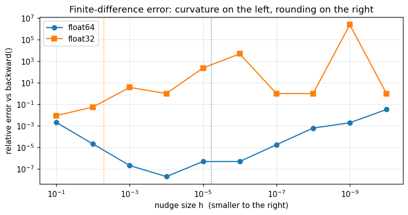
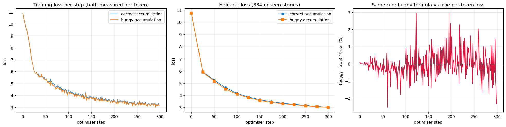
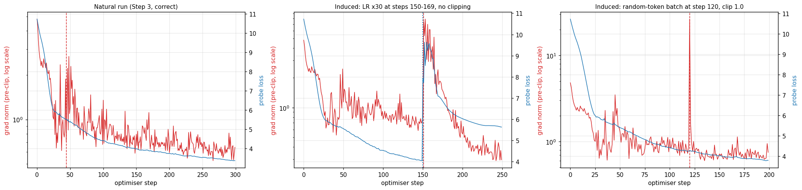

# Assignment 10 — The Training Loop, Made to Tell the Truth

Session 10 of ERA V5 says *every serious training bug is silent*. This assignment takes a real model and a real
training loop and checks each part of a training step by printing and measuring it, instead of trusting it.

- **Model:** a 29.9M-weight Llama-style decoder written from scratch ([`model.py`](model.py): RMSNorm, RoPE, SwiGLU, tied embeddings)
- **Data:** TinyStories, 20,000 real stories, GPT-2 BPE tokens (4.47M tokens, story length 54 to 1,107 tokens)
- **Loop:** AdamW, bf16 mixed precision, gradient accumulation, gradient clipping, padding excluded from the loss
- **Hardware:** Google Colab, NVIDIA L4 (24 GB, Ada Lovelace), PyTorch 2.11

Notebook: [`session10_training_loop.ipynb`](session10_training_loop.ipynb). It runs top to bottom, with outputs and plots
saved in it. Every number below is copied from that run.

## Results

| Task | Result |
|---|---|
| Parameter count, hand formula vs measured | 29,938,560 vs 29,938,560 (64.5% of it is the tied embedding / LM head) |
| Loss at initialisation vs uniform guess $\ln V$ | 10.8785 vs 10.8258 |
| Memory per weight for training (measured) | 4 (fp32 weight) + 4 (fp32 grad) + 8 (AdamW) = **16.0 bytes** |
| Gradient check: the lesson's chain | `backward()` 64.0, finite difference 64.00000001 |
| Gradient check: 6 weights across the real model, float64 | relative difference between 9.2e-09 and 5.2e-06 |
| One gradient step on all 29.9M weights, actual / predicted $\Delta\mathcal{L}$ | 0.999996 at $\eta = 10^{-6}$, drifting to 0.08 at $\eta = 1$ |
| Accumulated gradient vs full-batch gradient, unequal token counts | correct: rel. diff 5.3e-07 · **buggy: rel. diff 0.20, cosine 0.983** |
| Same test, equal token counts | correct and buggy both 5.6e-07: **the bug disappears** |
| 300-step training runs, held-out loss at the end | correct 3.0205 · buggy 3.0106 |
| Buggy formula's printed loss vs the true per-token loss | up to +2.94% off on a single step |
| Grad norm moving before the loss, natural run | step 44: norm 1.883 → 0.706 while the probe loss moved +0.018, then −0.093 within 5 steps |
| Learning rate raised 30x at step 150 | loss alarm at step 150, norm alarm at step 151: **no lead** (explained below) |
| Random-token batch at step 120 | loss 17.4 and grad norm 26.4 at the **same** step: no lead, as predicted |
| Best bf16 matmul on this L4 | 69.2 TFLOP/s = 57% of the 121 TFLOP/s spec |
| **MFU** of full training steps | 6.6% (small micro-batches, eager) → 10.4% (16×512) → **12.0%** (`torch.compile`) |
| 0.1 in fp32 | `0 01111011 10011001100110011001101` = `0x3DCCCCCD` = 0.100000001490 (error 1.5e-8) |
| 0.1 in bf16 | `0 01111011 1001101` = `0x3DCD` = 0.10009765625 (error 9.8e-4) |
| 0.1 in fp8 E4M3 | `0 0011 101` = `0x1D` = 0.1015625 (error 1.6e-2) |

## Step 1 — Shapes

One forward pass on two real stories ($B = 2$, $T = 177$), every dimension named:

```
tokens              (B=2, T=177)                      input token ids
embed               (B=2, T=177, D=384)               one D-dim vector per token
block0 qkv          (B=2, T=177, 3D=1152)             query, key and value for every position
block0 q (per head) (B=2, H=6, T=177, hd=64)          queries split into 6 heads of width 64
block0 scores       (B=2, H=6, Tq=177, Tk=177)        how much each position attends to each other position
block0 attn out     (B=2, T=177, D=384)               heads concatenated back
block0 mlp hidden   (B=2, T=177, F=1024)              widened features inside the MLP
block0 block out    (B=2, T=177, D=384)               residual stream after the layer
logits              (B=2, T=177, V=50304)             a score for every vocabulary entry at every position
per-token loss      (354,)                            339 real tokens + 15 padding (loss exactly 0 there)
loss                ()                                one number
```

The initial loss is 0.053 above $\ln V$ because the logits are not exactly equal at initialisation (std 0.393). For
random logits with spread $\sigma$ the expected loss is about $\ln V + \sigma^2/2 = 10.826 + 0.077 = 10.90$, close to the
10.88 measured.

The gradients are fp32 although the forward pass ran in bf16. Autocast casts weights to bf16 *for each matmul*, but
stores them as fp32 master weights, so gradients land in fp32. The lesson's 16 bytes per weight is split differently
here (4 + 4 + 8 rather than 2 + 2 + 4 + 8), but the total is the same.

## Step 2 — Gradient check



The central difference $\frac{\mathcal{L}(w+h) - \mathcal{L}(w-h)}{2h}$ has two errors pulling in opposite directions:
curvature, which grows with $h$, and rounding, which grows as $h$ shrinks. In **float64** the error forms the expected U
shape, from 2.1e-3 at $h = 0.1$ down to **2.0e-8 at $h = 10^{-4}$**, then up again to 3.3e-2 at $h = 10^{-10}$.

In **float32 the check never works**, at any $h$. The loss is about 10.33, and fp32 values near 10 are spaced
9.54e-7 apart, while this weight's gradient is only 2e-4. A nudge of $h = 10^{-3}$ moves the loss by 2e-7, which is less
than one spacing. So every fp32 estimate came out as a whole number of spacings divided by $2h$: 0, 9.54e-4 (one spacing
at $h = 10^{-3}$), 4.77e-2 (one spacing at $h = 10^{-5}$). This isn't a wrong gradient; the measurement can't resolve
the change. It is also why a check that "fails" deserves a closer look before you blame `backward()`.

## Step 3 — Gradient accumulation, broken on purpose

**Why micro-batches carry different numbers of real tokens.** The loss is averaged over tokens that count, and many
positions do not count: padding (label −100), masked prompt tokens in instruction tuning, and different micro-batches
on different GPUs. Here stories are length-bucketed (sorted, then batched by similar length), so one micro-batch held
572 real tokens and another in the same step 2,008.

**The bug.** The correct loss divides the summed loss by all real tokens, $\frac{\sum_i S_i}{\sum_i n_i}$; the bug
averages each micro-batch's mean, $\frac{1}{K}\sum_i \frac{S_i}{n_i}$. That gives a token in micro-batch $i$ the weight
$\frac{1}{K n_i}$ instead of $\frac{1}{\sum n}$, so short micro-batches get a bigger vote. **The fix** is to count all
real tokens of the step first, then call `backward(S_i / n_total)` on each micro-batch. This is what training libraries
changed to in 2024.



- **On the gradient, the bug is large and measurable.** Compared with the true full-batch gradient, it is 20% off in
  size and direction (cosine 0.983), while correct accumulation matches to 5e-7. With equal token counts both match
  exactly, which is how the bug hid for years.
- **On the printed loss (right panel)**, the buggy formula strays from the truth by up to ±3% per step, but averages
  out to −0.03%. A loss curve would look perfectly reasonable.
- **On training outcome, it was not visible in this run.** The buggy run ended at 3.0106 held-out loss vs 3.0205 for
  the correct one, and was slightly *ahead* for most of training (largest gap −0.116 at step 75). AdamW normalises update
  sizes, which damps the effect of reweighting, and over 300 steps on one seed a 0.01 difference is within run-to-run
  noise. I can't claim from this run that the bug makes training worse here. What it shows is the lesson's point: the
  optimiser was trained on a different objective than intended, and nothing in the loss curve said so.

## Step 4 — The grad norm as an early warning

**Is it true that the grad norm moves before the loss?** Often, not always. Near a minimum,
$\lVert g\rVert \approx \lambda\delta$ grows *linearly* with the distance $\delta$ from the bottom, while the loss excess
$\tfrac12\lambda\delta^2$ grows *quadratically*. When an instability builds up gradually, the norm doubles while the loss
change is still lost in the batch noise. When the cause is a sudden event, both move together.

The loss used here is a **probe loss**: the loss on a fixed set of 16 held-out stories, measured after every step and
never trained on. The training loss comes from a different batch each step (different stories, different lengths), so
it jumps around even when the model does not change. The probe loss only changes when the model does.

- **Natural run:** a programmatic search (norm change $|z| > 2$, probe loss change $|z| < 1$, then a loss move at least
  twice as large within 5 steps) found 8 candidates. The strongest is **step 44**: the norm fell from 1.883 to 0.706 while
  the probe loss moved only +0.018, then it fell by 0.093 within the next 5 steps. Steps 43–49 are the end of the fast
  initial descent, where the norm swings 0.85 → 1.88 → 0.71 → 1.43 before the loss settles.
- **Learning rate ×30 at step 150: the norm did not lead.** The loss alarm went off at step 150 (4.03 → 7.95) and the
  norm alarm at step 151 (0.81 → 7.39). Two reasons. First, the jump is sudden, not a gradual build-up, so there is
  nothing for the norm to warn about in advance. Second, the logging is offset by one step: the grad norm at step $t$ is
  measured *before* that step's update, and the probe loss *after* it. Aligned on the same weights, both moved at once. The damage was lasting: 80 steps after the spike ended, the probe loss was still about 5.6, against 4.0 before it.
- **Random-token batch at step 120 (a corrupted shard): the norm did not lead, as predicted.** Training loss 17.4 and
  grad norm 26.4 jumped at the same step, because both are computed on that same bad batch. Clipping mattered: with
  clipping the probe loss rose by 0.041 and was back below its old level 2 steps later; without clipping it rose by 0.14
  (4.28 → 4.42) and was still above its old level 5 steps later. The damage is bounded even without clipping, because AdamW divides by a running
  gradient scale, so one enormous gradient cannot produce an enormous step.



Left: natural run, dashed line at step 44. Middle: learning rate ×30 from step 150, no clipping (red dashed = norm alarm, blue dotted = loss alarm). Right: random-token batch at step 120, clipping on. Red = grad norm (log scale), blue = probe loss.

## Step 5 — MFU

**MFU** compares the useful work done with what the GPU could do at best:

$$
\text{MFU} = \frac{\text{FLOPs per token} \times \text{tokens per second}}{\text{peak FLOP/s}},
\qquad \text{FLOPs per token} \approx 6N + 12\,L\,D\,T
$$

$6N$: every weight costs 2 FLOPs per token in the forward pass (one multiply, one add) and 4 in the backward pass
(gradient for the input and for the weight). $12LDT$ covers the attention-score matmuls, which have no weights.
For this model at $T = 512$ that is 193.8 MFLOP per token. Peak for the L4 is 121 TFLOP/s dense bf16. The measurement
covers **complete training steps of the whole model**: forward through all 6 layers and the head, loss, backward,
clipping and the AdamW update, with `torch.cuda.synchronize()` around the timer.

| Configuration | real tokens/s | TFLOP/s | MFU |
|---|---:|---:|---:|
| 1. Step 3's micro-batches of 8 stories, eager | 42,622 | 7.9 | 6.6% |
| 2. packed 16 × 512 tokens, eager | 65,226 | 12.6 | 10.4% |
| 3. packed 16 × 512, `torch.compile` | 75,011 | 14.5 | **12.0%** |
| 4. packed 32 × 512, `torch.compile` | 74,978 | 14.5 | 12.0% |

**What costs the distance to 40%:**

1. **This GPU's practical ceiling is about 57% of its spec.** The best possible case, a large square bf16 matmul,
   reached 69.2 TFLOP/s, not 121. The L4 is a 72 W inference card. So 40% of spec would mean about 70% of what this card
   actually delivers.
2. **The model is too narrow for the hardware.** With $D = 384$, every matmul is tall and thin (inner dimension 384), and
   reached only 57–61 TFLOP/s even in isolation. A roofline estimate puts them close to memory-bound (188–278 FLOPs per
   byte, against about 400 needed to be compute-bound on the L4).
3. **The vocabulary dominates a small model.** 64.5% of the weights are the 50,304 × 384 head, and the profiler shows
   where the time goes: `aten::copy_` (dtype casts, including upcasting the 8192 × 50304 logits to fp32 for the loss)
   takes 21.5% of GPU time, the log-softmax backward over 50k classes 19.5%, and all matmuls together 19.0%. The LM-head
   matmul alone ran at only 34 TFLOP/s. A fused, chunked cross-entropy kernel that never materialises fp32 logits would
   attack the largest item.
4. **Small batches (config 1).** 8 stories hold 1,000–4,000 tokens, too few to keep the GPU busy, which costs a third of
   the throughput. Padding was *not* the cost here: length bucketing had already removed it (0.0%).
5. **Kernel launch overhead and unfused elementwise ops.** `torch.compile` fused RMSNorm, SiLU and RoPE and gained 15%.
   Doubling the batch from 16 to 32 sequences gained nothing, so the step is limited by the bandwidth-bound work above,
   not by launch overhead.

## Step 6 — 0.1 in fp32, bf16 and fp8 E4M3

Decoding formula, with bias $= 2^{E-1} - 1$:

$$
\text{value} = (-1)^s \times \Big(1 + \frac{m}{2^M}\Big) \times 2^{\,e - \text{bias}}
$$

Worked by hand: $0.1 = 0.0001\,1001\,1001\,1001\ldots_2 = 1.1001\,1001\ldots_2 \times 2^{-4}$, so $p = -4$, and the
fraction bits `1001` repeat forever. In all three formats the bits cut off start `1100…`, which is 0.8 of the last kept
bit, so all three round up.

| | fp32 | bf16 | fp8 E4M3 |
|---|---|---|---|
| layout (sign-exp-mantissa), bias | 1-8-23, 127 | 1-8-7, 127 | 1-4-3, 7 |
| stored exponent | $-4 + 127 = 123$ = `01111011` | $-4 + 127 = 123$ = `01111011` | $-4 + 7 = 3$ = `0011` |
| mantissa | `10011001100110011001101` (m = 5,033,165) | `1001101` (m = 77) | `101` (m = 5) |
| decoded | 0.100000001490116 | $(1 + 77/128)/16$ = 0.10009765625 | $(1 + 5/8)/16$ = 0.1015625 |
| relative error | 1.5e-8 | 9.8e-4 | 1.6e-2 |
| worst-case bound $2^{-(M+1)}$ | 6.0e-8 | 3.9e-3 | 6.25e-2 |

A from-scratch encoder (exact fractions, no dtype casts) produced bit patterns identical to what `struct` and PyTorch
store. fp32 → bf16 is just "keep the top 16 bits, rounded" (`0x3DCCCCCD` → `0x3DCD`), and bf16 → fp32 is exact.

**What happens to real tensors** (trained model from Step 3, relative error of non-zero values and share that became 0):

| Tensor | bf16 | fp16 | fp16 + loss scale 1024 | fp8, no scale | fp8, per-tensor scale |
|---|---|---|---|---|---|
| MLP weights | 1.4e-3, 0% | 1.7e-4, 0% | 1.7e-4, 0% | 3.2e-2, 3.4% | 2.2e-2, 0% |
| MLP gradients (median 4e-5) | 1.4e-3, 0% | 3.4e-4, 0.04% | 1.7e-4, 0% | 0.75, **99.99%** | 2.2e-2, 0% |
| embedding gradients (median 2.4e-8) | 1.4e-3, **0%** | 0.15, **57.5%** | 5.1e-4, 0.06% | 0.24, 99.6% | 4.1e-2, **79.8%** |

**Which one I would train in: bf16 mixed precision**, with bf16 matmul inputs and fp32 master weights, gradients,
softmax, loss and optimiser state, as this notebook does.

- **Range matters more than precision.** The tied embedding's gradients have a median of 2.4e-8: fp16 zeroes **57.5%**
  of them. bf16 zeroes none, with no loss scaling to tune.
- **bf16's error is the same at every scale.** Its median error was 1.35e-3 on weights, activations and gradients alike
  (worst 3.89e-3, at the 3.9e-3 bound). Scaling a tensor cannot change that, because floating-point error is relative.
  Precision is protected another way: tensor cores add up bf16 products in fp32, autocast runs softmax, norms and loss
  in fp32, and the master weights stay fp32 so tiny updates are not rounded away.
- **fp8 E4M3 needs finer scaling than per-tensor.** The embedding gradients span 13 orders of magnitude (1.5e-15 to
  2.9e-2), while E4M3 covers about 5. With one scale for the whole tensor, 79.8% still became zero. This is why
  production fp8 recipes use per-block scales, like the 16-value blocks of the lesson. For a 30M model on an L4 the
  machinery isn't worth it.

## Limits of this work

- One seed per experiment. The Step 3 outcome difference (0.01) is not distinguishable from seed noise without more runs.
- Step 4's lead detector depends on thresholds that I chose ($|z| > 2$, a 5-step look-ahead). Different thresholds would
  pick different steps.
- MFU uses the 121 TFLOP/s datasheet peak. The card's real ceiling is lower and may vary with temperature and clocks,
  which I didn't monitor.
- fp8 was simulated by casting (`torch.float8_e4m3fn`); no fp8 matmuls were run.

## Running it

Open the notebook in Colab (or VS Code connected to a Colab kernel), select an **L4 GPU**, and Run All.
It installs `tiktoken` and `datasets` and downloads one 249 MB TinyStories shard (17 s). The two 300-step training
runs of Step 3 take about 2 minutes; I did not time the whole notebook.
