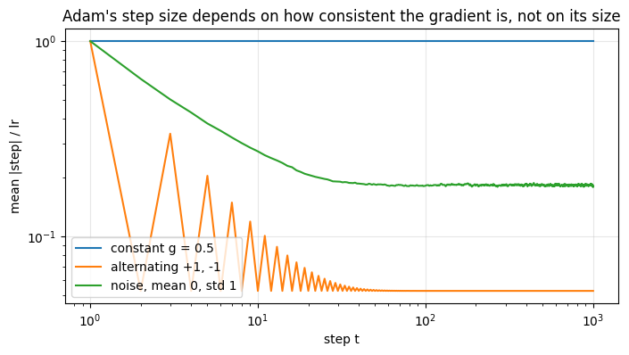
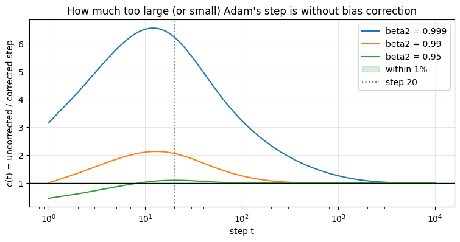
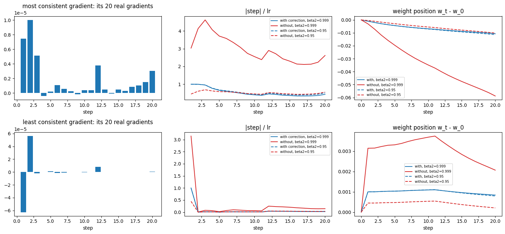
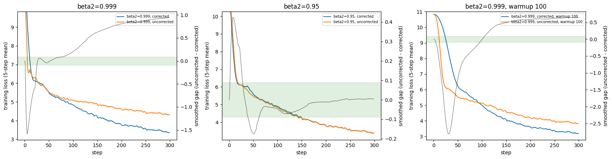
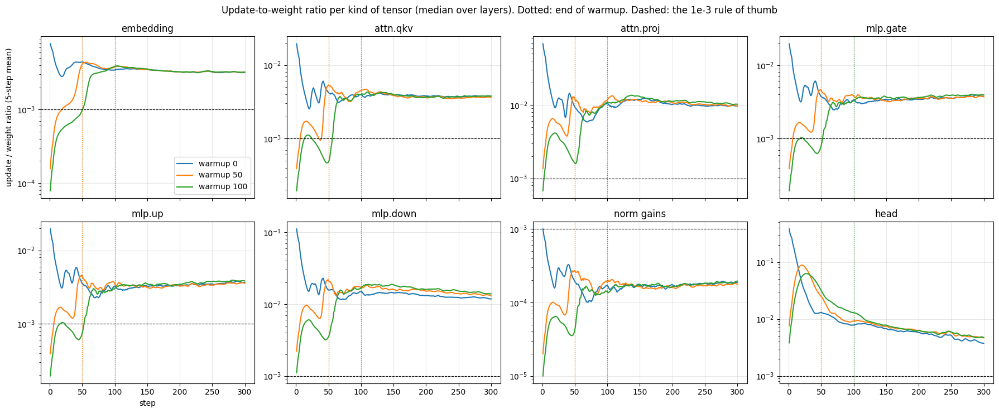
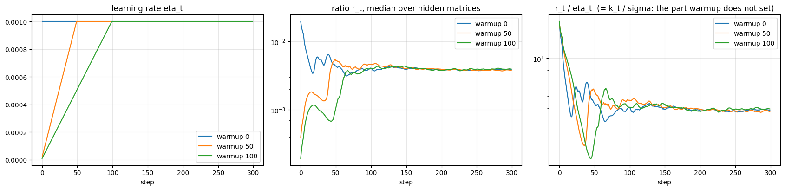
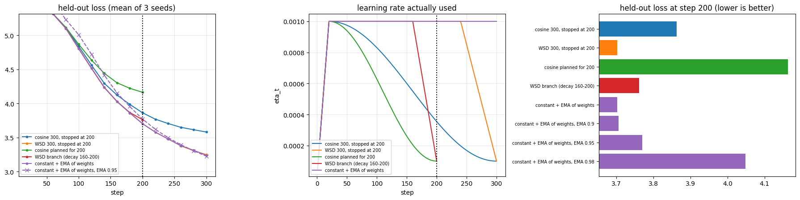
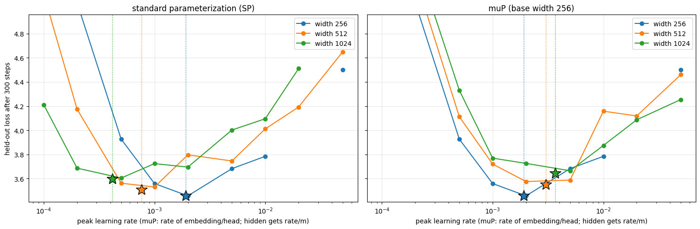
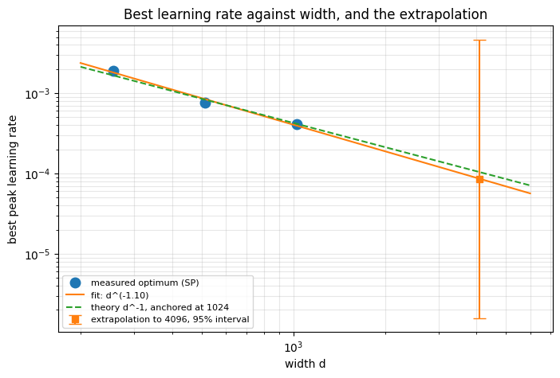

# Assignment 11: Optimizers and Learning-Rate Schedules

A gradient tells a weight which way to move, but not how far. An optimizer decides the distance. This assignment
checks Adam, bias correction, warmup, learning-rate schedules and learning-rate transfer across model widths on a
real model trained on real text. Each result is predicted by hand first and then measured.

| | |
|---|---|
| Model | Llama-style decoder written from scratch ([`model.py`](model.py)), 49.3M weights (6 layers, width 384). Width sweep: 4 layers at widths 256, 512, 1,024 |
| Data | TinyStories, 40,000 stories, GPT-2 tokens (9.0M tokens, 5% held out for evaluation) |
| Training | AdamW, 300 steps of 8,192 tokens each. Runs with the same seed start from the same weights and see the same batches, so compared runs differ only in the setting being tested |
| Hardware | Colab Pro, NVIDIA A100 40 GB. The full notebook (about 85 training runs) takes 22 minutes |

Notebook: [`session11_optimizers.ipynb`](session11_optimizers.ipynb), executed with all outputs saved. Every number
below comes from that run. "Loss" means held-out loss (lower is better).

## Results

| Task | Result |
|---|---|
| 1. Adam by hand vs PyTorch | Same weights to the last digit in float64; differences below $3\times10^{-8}$ in float32 |
| 2. Bias correction switched off | Steps are 3.2× too large at step 1 and 6.6× at step 12. They match the corrected steps within 1% only after **3,925 steps** (β₂ = 0.999), or **76 steps** (β₂ = 0.95) |
| 3. Update-to-weight ratio under warmup | Warmup stops changing the ratio at about **step 115 to 130**, for both a 50-step and a 100-step warmup |
| 4. Cosine vs WSD, stopped at step 200 | Cosine 3.863, **WSD 3.702** (3 seeds). **Keep the WSD model** |
| 5. Best learning rate at widths 256 / 512 / 1,024 | 1.9e-3 / 7.6e-4 / 4.2e-4. For width 4,096: **1e-4**, low to moderate confidence |

---

## Task 1: Adam by hand

**What Adam does.** It keeps two running averages for every weight and steps by their ratio:

$$w \leftarrow w - \eta \cdot \frac{\hat m}{\sqrt{\hat v} + \epsilon}$$

- $\eta$ is the learning rate (here 0.001).
- $m$ is the running average of the gradient. It remembers about the last 10 gradients, set by $\beta_1 = 0.9$.
- $v$ is the running average of the gradient squared, so $\sqrt v$ is the typical size of this weight's gradient.
  It remembers about the last 1,000 gradients, set by $\beta_2 = 0.999$.
- $\hat m$ and $\hat v$ are the same averages after **bias correction**. Both averages start at 0 and read too low
  for the first steps. Dividing them by $(1-\beta^t)$ fixes that exactly.
- $\epsilon = 10^{-8}$ is there only to avoid dividing by zero.

**Step 1 by hand** (start at $w = 1$, first gradient 0.5): $m = 0.05$, $v = 0.00025$, $\hat m = 0.5$, $\hat v = 0.25$,
so the step is $-0.001 \times 0.5 / 0.5 = -0.001$ and $w$ becomes 0.999.

| Check | Largest difference from the hand calculation |
|---|---:|
| `torch.optim.Adam` and `AdamW`, float64, 5 steps | 0 |
| Same, float32 | 1.3e-8 to 3.1e-8 (float32 rounding) |
| A real 442,368-weight attention matrix, 5 real gradients | 1.5e-8, while each step moves a weight by about 1e-3 |

The five-step table from the lesson is reproduced to six decimals (w = 0.999000, 0.998012, 0.997018, 0.996028,
0.995031).

### Why Adam's step is not always the learning rate

The lesson says Adam moves every weight by about $\eta$. Half of that is true: **the size of the gradient does not
matter.** Dividing by $\sqrt v$ cancels it, so a weight with gradients of 0.5 and a weight with gradients of 0.0005
take the same step.

The other half needs a condition: **the step is close to $\eta$ only if the gradient keeps pointing the same way.**
$m$ averages the gradients *with their signs*, so gradients that flip sign cancel inside $m$. $v$ averages squares,
which are always positive, so they never cancel. The result is a small $m$ divided by an unchanged $\sqrt v$: a small
step.

To show this, we fed three made-up gradient patterns to Adam, each to 10,000 weights. The table gives the average
step size once Adam has settled, as a fraction of $\eta$ (1.0 means a full step of 0.001):

| Gradient pattern | Example | What happens inside Adam | Step / η |
|---|---|---|---:|
| Always the same | 0.5, 0.5, 0.5, … | $m$ = 0.5 and $\sqrt v$ = 0.5, ratio 1 | **1.000** |
| Flips every step | +1, −1, +1, −1, … | $m$ only reaches ±0.053, $\sqrt v$ = 1 | **0.053** |
| Random, average zero | noise of size 1 | $m$ is mostly cancelled noise, $\sqrt v$ = 1 | **0.183** |

All three match the hand predictions. Real gradients sit between these patterns: the average step in the real
attention matrix fell from 1.00 η at step 1 to 0.35 η at step 5, as its gradients quickly stopped agreeing.

*Each line is one gradient pattern. Y-axis: average step size divided by η. X-axis: step number (log scale).*

The lesson gives 0.281 η for random gradients. We measure 0.183 once settled (0.448 averaged over the first 10
steps, 0.216 over the first 100), so we could not reproduce that figure.

### Two smaller checks

| Check | Expected | Measured |
|---|---|---|
| Weight decay. Weight A has large gradients, weight B gradients 100× smaller. How much harder is B decayed? | Lesson: 100× with L2 regularization, 1× with AdamW | **17×** with L2, **1.00×** with AdamW |
| Training memory per weight with AdamW | 16 bytes | 4 (weight) + 4 (gradient) + 8 (Adam's $m$ and $v$) = **16 bytes** |

L2 decays B only 17× harder, not 100×, because Adam never moves a weight much more than $\eta$ per step, which caps
the gap. The memory result means a 9B-parameter model needs 134 GiB just for these four numbers, and half of that is
the optimizer's $m$ and $v$.

---

## Task 2: Bias correction switched off

**What changes.** Without correction, Adam uses $m$ and $v$ directly. That multiplies every step by a factor that
depends only on the step number $t$:

$$c(t) = \frac{\text{step without correction}}{\text{step with correction}} = \frac{1-\beta_1^t}{\sqrt{1-\beta_2^t}}$$

At step 1 with $\beta_1 = 0.9$ and $\beta_2 = 0.999$: $c = 0.1 / \sqrt{0.001} = 3.16$, so the first step is 3.16 times
too large. $c(t) = 1$ means switching correction off makes no difference.

**How "stops mattering" is measured.** "Within 1% from step N" means: from step N onward, the uncorrected step is
always between 0.99 and 1.01 times the corrected step. Before step N it was outside that range at least once.
"Within 10%" uses 0.90 to 1.10 instead.

| β₂ | Factor at step 1 | Largest factor | Factor at step 20 | Within 10% from step | Within 1% from step |
|---:|---:|---:|---:|---:|---:|
| 0.999 (lesson default) | 3.16 | 6.57 (step 12) | 6.24 | 1,751 | **3,925** |
| 0.99 | 1.00 | 2.13 (step 13) | 2.06 | 175 | 391 |
| 0.95 (common for LLMs) | 0.45 | 1.10 (step 20) | 1.10 | 6 | **76** |

With β₂ = 0.999 the error does not shrink at first, it grows: steps become 6.6 times too large around step 12.
$m$'s correction is done after about 44 steps, but $v$'s takes thousands, because $v$ has a much longer memory. With
β₂ = 0.95 the first steps are *smaller* than they should be, which works like a short warmup.

*The factor c(t) for three values of β₂. The green band is "within 1%".*

### The first 20 steps of two real weights

We recorded 20 real gradients of two weights from the model and ran each sequence through Adam with and without
correction. One weight had a fairly consistent gradient (top row), the other a noisy one (bottom row).

How to read the three panels in each row:

| Panel | What it shows |
|---|---|
| Left: the 20 real gradients | the gradient this weight received at each step |
| Middle: `|step| / lr` | how far the weight moved at that step, divided by the learning rate. 1 means it moved exactly 0.001; 4 means four times that. Direction is ignored |
| Right: `weight position w_t − w_0` | where the weight is after t steps, measured from its starting value: the running total of all its steps, with direction |

The red solid line (no correction, β₂ = 0.999) sits 3 to 6 times above the blue line in the middle panels, as the
factor predicts. In the top-right panel that weight ends up **5.5 times further** from its start (0.059 vs 0.011).
With β₂ = 0.95 (dashed lines) the two versions almost overlap. **Within these 20 steps the difference never stops
mattering for β₂ = 0.999.**

### On the real model (300 steps)

| Run | Loss at step 300 | Gap |
|---|---:|---:|
| β₂ = 0.999, with / without correction | 3.231 / 4.211 | **+0.98** |
| Same, with a 100-step warmup | 3.051 / 3.722 | +0.67 |
| β₂ = 0.95, with / without correction | 3.243 / 3.266 | +0.02 (seed-to-seed noise) |
| Two seeds, both with correction (noise level) | 3.231 / 3.249 | 0.02 |

The uncorrected β₂ = 0.999 run is actually *ahead* for the first ~25 steps, since bigger steps help while the loss is
still near its starting value of 10.8. After that it falls behind and stays behind, because its steps remain 2 to 6.6
times too large for the whole run. Warmup does not fix this: warmup ends at step 100, but the factor stays above 2
until about step 290. With β₂ = 0.95 switching correction off is harmless: the gap falls inside the noise from step
63, close to the 76 steps predicted above.

*Coloured lines: training loss with and without correction. Black line (right axis): the gap between them. Green
band: the seed-to-seed noise.*

---

## Task 3: Update-to-weight ratio and warmup

**What the ratio is.** For one weight matrix, the update-to-weight ratio is the size of one step's change divided by
the size of the matrix itself. 0.01 means one step changed the matrix by 1% of its size. The lesson's rule of thumb is
that it should stay near 0.001.

**How warmup connects to it.** Adam moves each weight by about η × (gradient consistency), as Task 1 showed. So:

$$\text{ratio} \approx \frac{\eta \times \text{consistency}}{\text{typical weight size}}$$

During warmup η grows step by step, which pushes the ratio up. After warmup η is constant, and the ratio changes only
when the gradients get less consistent or the weights grow. **"The step where warmup stops changing the ratio" is
where the first effect gives way to the second.**

**Check at step 1, no warmup.** At step 1 every weight moves by exactly η, so ratio = η / weight size:

| Matrix | Weight size | Predicted | Measured |
|---|---:|---:|---:|
| attention qkv, MLP gate and up | 0.051 | 0.0196 | 0.0196 |
| attention output | 0.015 | 0.068 | 0.068 |
| MLP down | 0.009 | 0.111 | 0.111 |
| norm gains | 1 | 0.001 | 0.001 |
| output head | 0.0026 | 0.384 | 0.381 |

This is the lesson's "first step about 19 times too large" (0.0196 against the 0.001 rule). With a warmup of W steps,
step 1 uses η/W, so the first ratio is W times smaller.

**Result (warmup 0, 50 and 100 steps, constant rate afterwards):**

| Matrix type | Warmup run matches the no-warmup run (within 10%) from step |
|---|---|
| attention qkv, MLP gate and up, norm gains | **113 to 131**, for both warmup 50 and 100 |
| embedding | right after warmup ends (53 and 109) |
| attention output | 122 (warmup 50), 264 (warmup 100) |
| MLP down, output head | never within 300 steps: they stay 10–25% higher with warmup |

So warmup stops changing the ratio at about **step 115 to 130** for most layers, and a 100-step warmup hands over at
about the same point as a 50-step one. The two layers that never match start with the smallest weights. Without warmup
their first steps were 11% and 38% of their own size, which made those weights permanently larger.

*One panel per type of matrix. Colours: warmup 0 / 50 / 100. Dotted lines: end of warmup. Dashed line: the 0.001
rule of thumb.*

*Left: the learning rate. Middle: the ratio. Right: ratio ÷ learning rate, the part warmup does not control. It falls
from about 20 to about 4 in all three runs: early gradients agree with each other, later ones do not. That is why
warmup is needed.*

The 100-step warmup also gave the best loss at step 300 (3.04, against 3.21 for warmup 50 and 3.26 for no warmup).

---

## Task 4: Cosine vs WSD, stopped at step 200

Both schedules are planned for 300 steps and stopped at step 200. **Cosine** lowers the learning rate smoothly from
step 20, and at step 200 is at 36% of its peak. **WSD** (warmup, stable, decay) holds the peak until step 240 and
decays only at the end, so at step 200 it is still at full rate. The peak rate was tuned separately for each schedule;
both came out best at 0.001. Each setup ran with 3 seeds.

| Model | Loss at step 200 | Loss at step 300 |
|---|---:|---:|
| cosine, planned for 300 | 3.863 ± 0.044 | 3.580 |
| **WSD, planned for 300** | **3.702 ± 0.035** | 3.248 |
| *extra:* cosine planned for 200 (fully decayed at 200) | 4.164 | — |
| *extra:* WSD decayed from step 160 to 200 | 3.762 | — |
| *extra:* constant rate | 3.702 | 3.238 |
| *extra:* constant rate, averaged weights (last ~10 steps) | 3.705 | **3.205** |

**I would keep the WSD model.** It beats cosine on every seed, by 0.16 on average, and because it was saved during the
flat phase it can still be trained further or decayed later. The cosine model is half-decayed from a run that was cut
off.

**This surprised me.** I expected cosine to win at step 200, because a lower learning rate usually lets the weights
settle. Here every decay made the loss *worse*. After only 300 steps the model is far from trained: the loss still
drops about 0.25 every 50 steps. At that stage progress depends on how far the weights can travel, so the run with
the most learning rate so far wins at step 200. The benefit of decaying shows up in much longer runs.

*Left: loss over training (mean of 3 seeds). Middle: the learning rate each run used. Right: loss at step 200.*

---

## Task 5: Learning-rate sweep across widths

**Why the best learning rate depends on width.** Adam moves each weight by about η whatever the model's width. A
layer's output adds up the contributions of all its inputs. With twice as many inputs, the same per-weight step
changes the output about twice as much. So in the standard setup the best η should roughly halve each time the
width doubles. **muP** is a way of setting up the model that builds this correction in, so that one η should be best
at every width.

Sweep: 9 learning rates from 1e-4 to 5e-2, 300 steps each, at three widths, in the standard setup and with muP.

| Width | Best η (standard) | Best η (muP) | Seed-to-seed noise at the best point |
|---:|---:|---:|---:|
| 256 | 1.9e-3 | 1.9e-3 (same model) | 0.09 |
| 512 | 7.6e-4 | 3.0e-3 | 0.08 |
| 1,024 | 4.2e-4 | 3.7e-3 | 0.08 |

*Loss against learning rate. Stars mark the best learning rate at each width. Left: standard setup. Right: muP.*

**Standard setup:** the best η falls with width almost exactly as predicted. Fitting the three points gives
η ∝ width^−1.10, against the expected width^−1.

**Value for width 4,096: 1e-4.** The fitted line gives 8.6e-5, and halving per doubling from width 1,024 gives
1.0e-4.

**Confidence: low to moderate. I trust it to within a factor of 2 (5e-5 to 2e-4).** Reasons:
- The seed-to-seed noise (0.08) is as large as the difference between neighbouring learning rates, so each best value
  is uncertain by about one grid step.
- It is an extrapolation from 3 points to a width 4 times larger than any tested.
- 300-step runs prefer larger learning rates than full-length runs, so the real value is probably lower.

**muP:** the best η now varies only 1.9× across widths, against 4.6× in the standard setup. That is better but not
perfect, and it did not lower the loss. muP's job is to make a small-model sweep valid for a large model, not to make
the model better. If muP transfer holds, its width-4,096 estimate for the hidden layers is 1.2e-4 to 2.3e-4, close to
the standard-setup answer.

*Best learning rate against width (log scales), the fitted line, and the extrapolation to 4,096 with its very wide
95% interval.*

---

## Limits of this work

- **Short runs.** 300 steps on small models that are still far from trained. The schedule result in Task 4 holds for
  this early stage only. It is not a general ranking of cosine and WSD.
- **Noise.** Seed-to-seed differences are 0.02 to 0.04 (Tasks 2 to 4) and about 0.08 at the sweep optima (Task 5),
  as large as some of the effects measured. Task 4 tuned the learning rate on a single seed.
- **Width 4,096 was not trained.** Its value is extrapolated from 3 widths.
- **Thresholds are my own choices:** 1% and 10% for "stops mattering", 10% for "the warmup run matches", and a loss
  above 15 counting as diverged.
- **Simple muP:** only the hidden-layer learning rate and the output scale change with width.
- **Not reproduced:** the lesson's 0.281 η step for random gradients and its 100× weight-decay gap. The differences
  are explained above.

## A note on compute

During this course I once left a Colab runtime connected after a run had finished, and an idle GPU used up about 30%
of a month's credits. Real LLM training has the same failure on a much larger scale: expensive GPUs held by a job that
has stopped making progress. So this notebook ends with a cell that releases the runtime as soon as the last result is
printed.

## How to run

1. Open [`session11_optimizers.ipynb`](session11_optimizers.ipynb) in Colab with a GPU. An A100 runs it in about 22
   minutes.
2. Run all cells. The notebook installs `tiktoken`, writes `model.py`, downloads one TinyStories file and trains every
   model it reports.
3. The last cell releases the Colab runtime. If you use VS Code, save the notebook afterwards to keep the outputs.
