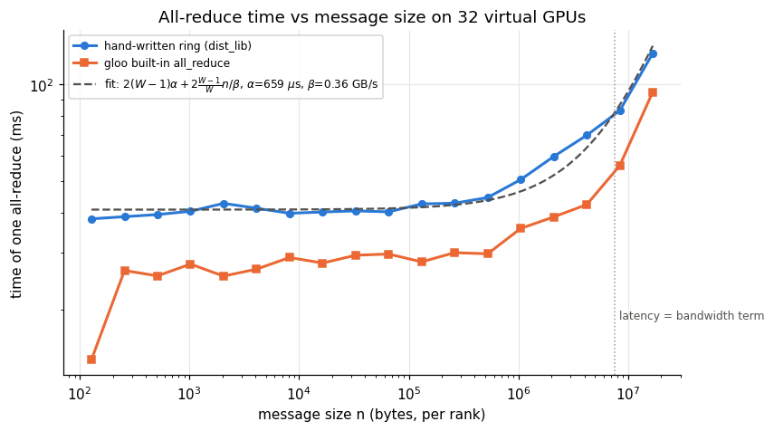
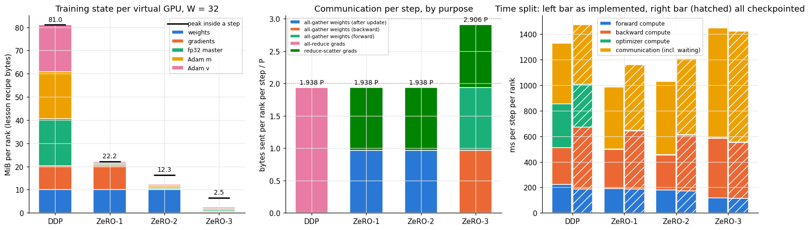
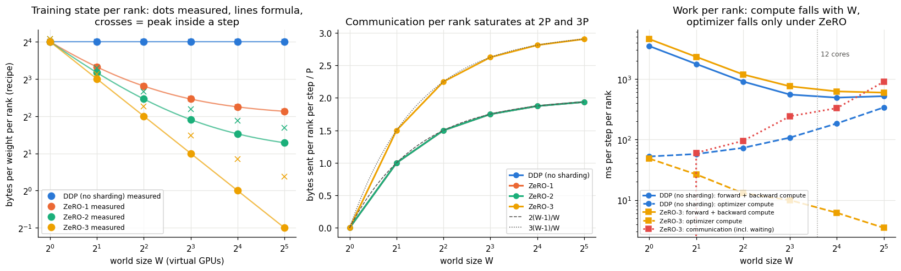
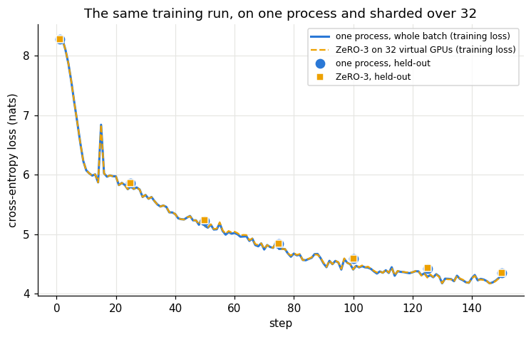
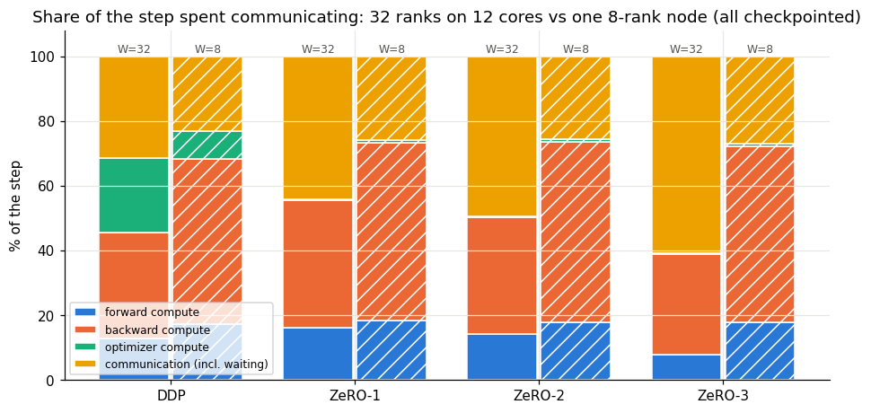
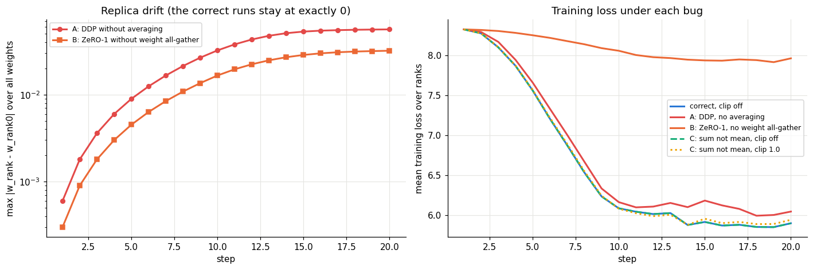
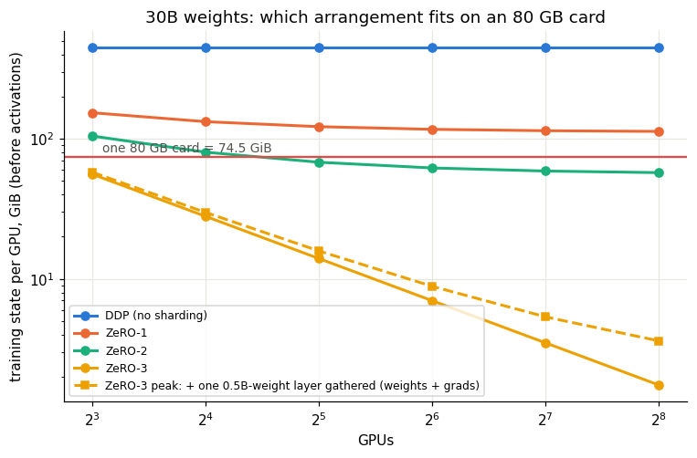

# Assignment 12 — Data Parallelism and ZeRO, Built and Measured on 32 Virtual GPUs

A 30-billion-weight model costs 16 bytes per weight to train (bf16 weight and gradient, fp32 master copy, two Adam
averages), 447 GiB, before a single activation. Session 12 is about spreading that over many GPUs and paying for it
in communication. For this assignment I built 32 virtual GPUs, wrote data parallelism and ZeRO stages 1, 2 and 3 from
scratch on top of them, trained a real transformer on real text with each, and measured how the memory, the
communication and the computation change. Every prediction is written down before its cell runs, and every number
below is copied from the executed notebook.

- **Virtual GPUs:** 32 operating-system processes started by `torchrun`, each with its own private memory, talking
  through `torch.distributed` (gloo backend). All gradient and weight traffic goes through ring collectives I wrote on
  point-to-point send/recv ([`dist_lib.py`](dist_lib.py)), so every byte each rank sends is counted.
- **Engine:** [`zero_sim.py`](zero_sim.py): DDP, ZeRO-1, ZeRO-2, ZeRO-3, a byte-exact memory ledger per rank, an
  activation counter (saved-tensor hooks), a per-phase timer, and three switchable bugs.
- **Model:** the Llama-style decoder from Assignments 10 and 11 (RMSNorm, RoPE, SwiGLU), [`model.py`](model.py),
  L = 4, D = 256, 5,310,720 weights, laid out as 6 *units* (embedding, 4 blocks, norm + head): the granularity at which
  ZeRO reduces gradients and gathers weights.
- **Data:** TinyStories, 60,000 stories, GPT-2 BPE remapped to the 4,095 most frequent tokens + 1 "rare" id (98.8% of
  the text kept), 13.3M tokens. Every step draws the same 64 sequences of 128 tokens on every rank; rank r takes its
  share, so 1 rank and 32 ranks see exactly the same data.
- **Hardware:** Colab A100 runtime, used for its 12 vCPUs and 167 GiB of RAM (the GPU is not used by the 32 ranks).
  PyTorch 2.11. The whole notebook runs in 18.2 minutes and releases the runtime at the end.

Notebook: [`session12_zero.ipynb`](session12_zero.ipynb), executed top to bottom with every output saved.

## Results

| Task / question | Measured |
|---|---|
| 32 virtual GPUs | 32 ranks, 32 distinct processes, gloo, 1 thread each |
| Collectives on hand-checkable numbers | all exact (error 0.0); reduce-scatter + all-gather = all-reduce |
| Bytes of a ring all-reduce per rank | **1.9375 × the message** = $2\frac{W-1}{W}$ at W = 32 |
| Training state per rank, W = 32 (lesson recipe bytes per weight) | DDP **16.000** · ZeRO-1 **4.375** · ZeRO-2 **2.4375** · ZeRO-3 **0.500** (all = formula) |
| … in MiB per rank | 81.04 · 22.16 · 12.35 · 2.53 |
| Peak inside a step | 81.04 · 22.16 · **16.35** · **6.53** MiB (one unit's full buffers on top) |
| Bytes sent per rank per step | DDP **1.9375 P** · ZeRO-1 **1.9375 P** · ZeRO-2 **1.9375 P** · ZeRO-3 **2.9063 P** |
| Weights each rank's optimizer updates | DDP 5,310,720 (100%) · every ZeRO stage **165,960 (3.125%)** |
| Optimizer time per rank | DDP 343 ms → ZeRO-1 **4.4 ms (78× less)** |
| Forward + backward compute per rank | unchanged by ZeRO (one core per rank: 48–51 GFLOP/s in every stage) |
| Same weights as one GPU after 4 steps (fp64) | max difference **1.3e-14** for every stage (updates were 3.0e-3) |
| The four stages against each other | **bit-identical** weights and losses |
| Lesson's table in real bf16 bytes, W = 8 | **16.0000 · 5.5000 · 3.7500 · 2.0000** bytes per weight; 1.75 P / 2.625 P sent |
| 150 training steps, ZeRO-3 × 32 vs one process | held-out loss **4.349 vs 4.346** |
| Bug: DDP without averaging | replicas drift by **6.0e-4 = 2η** after step 1, 5.6e-2 after 20 |
| Bug: ZeRO-1 without the weight all-gather | loss **7.96 vs 5.90** after 20 steps |
| Bug: gradients summed, not averaged | loss changes by only 4.2e-4 under Adam (clipping off), **1.5e-2** with clipping |
| One node, 8 ranks, one core each | communication / compute **30–39%** (vs 46–156% at W = 32 on the same 12 cores) |
| Capstone projection, 30B, 8 × B200 | fits under ZeRO-1/2/3, communication **0.5–0.7%** of the step, about **87 days per 300B tokens** |

## 1. Thirty-two virtual GPUs

A real multi-GPU job is W copies of one program, each with memory the others cannot read; data moves only by explicit
messages. Threads would share memory (and Python's GIL would run one at a time); a Python list of "GPUs" in one
process would make the network a `for` loop; NCCL refuses to put 32 ranks on one physical GPU. So each virtual GPU is a
**process**: `torchrun --nproc_per_node=32` starts 32 copies and gives each its `RANK` and `WORLD_SIZE`, and
`init_process_group("gloo")` connects them. The code is the same as real multi-GPU code; moving it to GPUs means
`"gloo"` → `"nccl"` and `cuda:LOCAL_RANK`.

The three collectives were checked on numbers I could predict by hand: rank r holds $x_r[c] = 100r + c$, so the
all-reduce of entry c is $100 \cdot \frac{31\cdot32}{2} + 32c = 49{,}600 + 32c$. gloo gave 49,600, 49,632, 49,664,
49,696; my ring reduce-scatter left rank r with exactly $49{,}600 + 32r$; reduce-scatter followed by all-gather matched
all-reduce with error 0.0.

## 2. The ring all-reduce, and why it scales

GPUs in a ring each send only to their right neighbour. **Reduce-scatter** ($W-1$ rounds): in round s rank r sends
chunk $(r-s-1)$ and adds what arrives into chunk $(r-s-2)$, so each message carries one more contribution, and after
$W-1$ rounds rank r holds chunk r complete. **All-gather** ($W-1$ more rounds) passes the complete chunks around.
Every send is $1/W$ of the data:

$$\text{bytes sent per rank} = 2\,(W-1)\cdot\frac{n}{W} = 2\,\frac{W-1}{W}\,n \;\to\; 2n$$

This **does not grow with W**, which is why ring all-reduce scales. The notebook prints a 4-GPU trace (6 sends,
every chunk ends at 1 + 2 + 3 + 4 = 10), and the measured bytes for a 128 KiB message on 32 ranks were 126,976 B per
phase and 253,952 B for the all-reduce, exactly the formula.

The time follows $t(n) = 2(W-1)\,\alpha + 2\frac{W-1}{W}\,n/\beta$:

The fit gives $\alpha$ = 659 µs per send and $\beta$ = 0.36 GB/s: every all-reduce on 32 ranks costs at least 41 ms,
flat up to about 512 KiB, and only above 7.2 MiB does bandwidth dominate. Those are poor numbers (32 processes take
turns on 12 cores, so a rank often waits for its neighbour to be scheduled), but the shape is the real one, and it is
the reason for gradient **buckets**: sending the 31 weight tensors one at a time would cost 31 × 41 ms = 1.3 s of
latency alone, 6 unit-sized buckets cost 0.25 s.

## 3. Data parallelism: the baseline

Every rank holds everything (16 bytes per weight), runs forward and backward on its own 2 sequences, **all-reduces**
the gradients and divides by W, and runs Adam on all weights. The average of 32 per-rank mean gradients is the mean
gradient of all 64 sequences, because each rank has the same number of sequences:

$$\frac{1}{W}\sum_{r}\frac{1}{b}\sum_{i\in r}\nabla\ell_i = \frac{1}{Wb}\sum_{i}\nabla\ell_i$$

so DDP is mathematically the same run as one GPU with a 32 times larger batch. Measured: 16.0000 bytes per weight
(81.04 MiB per rank; 32 ranks hold 2,593 MiB to store 81 MiB), 1.9375 P sent per step, 100% of the weights updated
on every rank, and after 4 fp64 steps the weights differ from a one-process run by at most 1.3e-14 while the 32
replicas are bit-identical.

## 4. ZeRO-1: shard the optimizer state

Under DDP all 32 ranks run the same Adam update on the same numbers. ZeRO-1 makes rank r responsible for **slice r**
of the weights, so it keeps the fp32 master copy and Adam's m and v only for that slice. Per step: full backward,
**reduce-scatter** the gradients (rank r receives the summed slice r), Adam on slice r, **all-gather** the updated
weights so every rank has the full model again.

$$\text{bytes per weight} = 2 + 2 + \frac{12}{W} = 4.375 \text{ at } W = 32$$

**It costs no extra communication** because DDP's ring all-reduce *is* a reduce-scatter plus an all-gather: ZeRO-1
does the same two phases, but all-gathers the updated weights instead of the summed gradients. Measured: 4.3750
bytes per weight (master, m, v each 0.125 = 4/32), 1.9375 P (0.9688 P reduce-scatter + 0.9688 P all-gather, plus 496
bytes for the gradient-norm all-reduce that clipping needs once each rank only holds a slice of the gradient), and
each rank's optimizer updates 165,960 weights instead of 5,310,720.

## 5. ZeRO-2: shard the gradients

After the reduce-scatter, rank r only ever uses slice r of the gradient, so ZeRO-2 does not keep the rest. Backward
produces gradients unit by unit (head first); a hook on each weight notices when a unit is complete, copies it into a
temporary buffer, **reduce-scatters it immediately, inside backward**, adds slice r to a persistent 1/W gradient, and
frees the buffer.

$$\text{bytes per weight} = 2 + \frac{2 + 12}{W} = 2.4375 \text{ at } W = 32$$

Measured: 2.4375 between steps, 1.9375 P (identical to ZeRO-1: the reduce-scatter only moved into backward). The
**peak** is 16.35 MiB (3.23 bytes per weight), not 12.35: while the head unit's gradient is being reduced, its full
2.0 MiB buffer and autograd's own 2.0 MiB copy exist on top of the slices. The between-steps number understates
ZeRO-2's real need by a third here, and what sets the gap is **the size of the largest unit, not the size of the
model**. That is why DeepSpeed's bucket size and FSDP's wrapping granularity are tuning knobs.

## 6. ZeRO-3: shard the weights

Rank r keeps only slice r of the weights too. A unit's full weights exist only while it computes: **all-gather**
before its forward, drop; **all-gather again** before its backward, compute gradients, **reduce-scatter** them, drop
everything. After the update no all-gather is needed: the next forward gathers anyway.

$$\text{bytes per weight} = \frac{16}{W} = 0.5,\qquad \text{bytes sent} = 3\,\frac{W-1}{W}\,P = 2.906\,P$$

Measured: **0.5000 bytes per weight** (2.53 MiB per rank, 32 times less than DDP), **2.9063 P**, peak 6.53 MiB (one
gathered unit's weights and gradient, 1.6 times the whole sharded state), and the same 1.3e-14 from one GPU.

**How I implemented it.** If autograd kept a unit's graph, the graph would reference the gathered weights and they
could not be freed between forward and backward. My `UnitFn` runs each unit without recording a graph and saves only
its input; in backward it gathers the weights again and **recomputes** the unit with autograd on. That is activation
checkpointing: one extra forward per step (+33% compute) and much smaller activations. PyTorch FSDP avoids the
recomputation by freeing the storage under the graph and refilling it in a backward hook. Weight and gradient memory
and bytes are the same either way. To keep the comparison fair, Section 9 of the notebook also runs every stage
with checkpointing.

## 7. All four, side by side

*Left: training state per rank (bars) and peak (black marks), W = 32. Middle: bytes per step, split by purpose.
Right: time per step, left bars as implemented, hatched bars with every stage checkpointed.*

| per rank, W = 32, fp32 | DDP | ZeRO-1 | ZeRO-2 | ZeRO-3 |
|---|---:|---:|---:|---:|
| state between steps (MiB, recipe) | 81.04 | 22.16 | 12.35 | 2.53 |
| peak in a step (MiB) | 81.04 | 22.16 | 16.35 | 6.53 |
| activations kept for backward (MiB) | 29.03 | 29.03 | 29.03 | 5.25 |
| bytes sent per step | 1.9375 P | 1.9375 P | 1.9375 P | 2.9063 P |
| weights updated per rank | 5,310,720 | 165,960 | 165,960 | 165,960 |
| optimizer compute (ms) | 342.6 | 4.4 | 4.5 | 3.5 |
| communication incl. waiting (ms) | 473 | 484 | 573 | 862 |
| step (ms) | 1,327 | 984 | 1,030 | 1,448 |

What the numbers say:

- **The four stages compute exactly the same thing.** Their fp64 weights after 4 steps are bit-identical to each
  other, and all differ from one process by the same 1.3e-14 (that comes from batching, not ZeRO). ZeRO changes
  where the numbers live and who computes which update, never what is computed.
- **Memory falls exactly by the formulas**, but **activations do not fall at all** (29 MiB in every stage without
  checkpointing; 5.25 MiB in every stage with it). For ZeRO-3 the activations are twice the training state, which is
  why ZeRO-3 almost always comes with checkpointing.
- **Computation:** forward and backward are unchanged by ZeRO. Every rank still runs the whole model on its own
  sequences. The optimizer is the part that shrinks: 78 times less time for 32 times fewer weights (the extra factor
  is cache: a 166k-weight slice fits, 5.3M weights × 5 tensors on 32 processes do not). On this CPU that made ZeRO-1's
  step 26% *faster* than DDP's.
- **Communication time** for ZeRO-3 is 1.86 times DDP's for 1.5 times the bytes: it makes 19 collectives per step
  instead of 6, and every ring round pays the 0.66 ms latency.
- One measurement looks like an effect but is not: checkpointed ZeRO-3's compute came out at 0.82 × DDP's. A ZeRO-3
  rank spends 860 ms per step waiting in collectives, which frees cores for the other processes, so its compute runs
  faster. With one core per rank (Section 11 below) the forward time is 184–200 ms in every stage.

## 8. The lesson's table in real bytes (bf16, 8 ranks)

With real bf16 weights and gradients and fp32 optimizer state, the actual bytes per weight on 8 ranks were
**16.0000, 5.5000, 3.7500, 2.0000**: the lesson's table, measured rather than computed. Bytes sent were 1.75 P
($2\cdot\frac78$) and 2.625 P ($3\cdot\frac78$), half of fp32's, and the loss after 3 steps (8.0982 in all four
stages) was within 4e-4 of fp64.

## 9. Changing the number of GPUs

- **Memory** matched $16$, $4 + \frac{12}{W}$, $2 + \frac{14}{W}$, $\frac{16}{W}$ at every W from 1 to 32 (to 3
  decimals). ZeRO-1 and ZeRO-2 flatten towards their floors (4 and 2 bytes: the replicated weights and gradients),
  only ZeRO-3 keeps halving. The crosses (peaks) sit about 0.79 bytes per weight above the line at every W: the
  largest unit does not shrink with W.
- **Bytes per rank** saturate at $2\frac{W-1}{W}P$ and $3\frac{W-1}{W}P$: 0, 1.0, 1.5, 1.75, 1.875, 1.9375 P and 0,
  1.5, 2.25, 2.625, 2.8125, 2.906 P. **In the middle plot DDP and ZeRO-1 are drawn but hidden under ZeRO-2:** the
  three send identical bytes (1.9375 P against 1.93752 P at W = 32, the difference being the 496-byte gradient-norm
  all-reduce). The notebook's plotting code now draws the three with different marker sizes; the saved image is from
  the run before that change.
- **Compute per rank** fell close to $1/W$ (3,500 → 1,774 → 908 → 553 ms for W = 1, 2, 4, 8) and then stopped
  (493 ms at 16, 520 at 32) because the machine has 12 cores. **DDP's optimizer got slower with W** (52 → 339 ms, the
  same update on more processes competing for memory) while ZeRO's fell (53 → 3.5 ms).
- **Communication overtakes compute as W grows:** ZeRO-3's communication time rose from 60 ms (W = 2) to 899 ms
  (W = 32) while its compute fell, crossing between W = 16 and 32. That is the lesson's point that faster GPUs make
  communication matter more, reproduced here by shrinking each GPU's share of the work instead. (In the right plot,
  ZeRO-3's communication is exactly 0 at W = 1, which a log axis cannot show, so the dotted line drops off the bottom.)

## 10. Training for real

150 steps of ZeRO-3 on 32 ranks (no rank ever held more than 2.5 MiB of training state between steps) against the same
run on one process: held-out loss 8.276 → 5.860 → 4.846 → **4.349**, against **4.346**. The runs agree to 6e-7 up to
step 25, then drift apart by up to 2.8e-2 in training loss (7.7e-3 held-out) without growing further. I had predicted
about 1e-3. In fp32 the two are not the same arithmetic (one multiply over 64 sequences vs 32 over 2, plus a ring sum),
and training turns tiny differences into different but equally good trajectories; the fp64 tests show the method
itself is exact. The loss spike at step 15 is in both runs, so it comes from the data and the learning rate, not the
sharding.

## 11. One real node: 8 GPUs

The 32-rank setup behaves like **one node with 32 GPUs** joined by one kind of wire. Real nodes have **8 GPUs** on
NVLink (450–900 GB/s), and nodes are joined by InfiniBand (about 50 GB/s), so a ring that leaves the node runs at
InfiniBand speed. On Colab's 12 vCPUs, 8 ranks can each be **pinned to their own core**, which removes the "waiting for
a core" artefact:

- Compute is the same in every stage: forward 184–200 ms and **48–51 GFLOP/s per core** for DDP, ZeRO-1, ZeRO-2 and
  ZeRO-3. Without checkpointing only ZeRO-3 pays its recomputation (+30% forward + backward; predicted +33%).
- Communication / compute is **30–39%** on the 8-rank node against **46–156%** for 32 ranks on the same 12 cores:
  about the same bytes per rank, but 4 times the work to hide them behind, and no waiting for a core.

**What this means for the capstone (a projection, assumptions in the notebook):** the 30B model's 447 GiB does not
fit on **one B200** (168 GiB usable). With the optimizer offloaded to CPU it would fit, but a 1M-token step would
take about 200 s of compute, roughly two years for 300B tokens. **One node of 8 B200s** holds it under every ZeRO stage
(ZeRO-1 154, ZeRO-2 105, ZeRO-3 56 GiB per GPU). Over NVLink, communication is 0.5–0.7% of a 25 s step, so the
limit is time: about **87 days per 300B tokens**. Four nodes would take about 30 days, but InfiniBand would turn 27–36%
of each step into communication unless it is overlapped with compute. For a single node I would choose **ZeRO-2**: on
180 GB cards it fits with 63 GiB left for activations and moves a third less data than ZeRO-3.

## 12. Where it breaks: three deliberate bugs

- **DDP without averaging:** each rank applies its own gradient. The replicas drift by **6.0e-4 after step 1, exactly
  2η** (Adam's first step is ±η per weight, with different signs on different ranks), and by 5.6e-2 after 20 steps.
  The mean loss is only a little worse (6.04 against 5.90), so a loss curve would not reveal that there are now 8
  different models.
- **ZeRO-1 without the weight all-gather:** each rank updates its slice and never receives the others. The drift is
  η after step 1, and the loss stalls at **7.96 against 5.90**, because each rank trains a model that is 7/8 frozen.
- **Summing instead of averaging (8 times too large a gradient):** under Adam, with clipping off, the loss changed by
  at most **4.2e-4**. Adam's step $\hat m/\sqrt{\hat v}$ ignores a constant factor except where $\sqrt v$ is comparable
  to ε, which is the case for weights with almost no gradient (rare-token embedding rows). I predicted about 1e-5, so
  ε matters more than I expected. With **clipping at 1.0** the difference grew to **1.5e-2**: the buggy run's
  gradient norm is 8 times larger, so it was clipped on all 20 steps against 9 of 20 for the correct run. Adam forgives
  the bug and clipping does not.

## 13. Back to V5's 30B model

The rules measured above, applied to 30B weights on 80 GB (74.5 GiB) cards: DDP and ZeRO-1 never fit (4 bytes per
weight of replicated weights and gradients alone is 111.8 GiB); ZeRO-2 fits from 32 GPUs (68.1 GiB, 6 GiB left);
ZeRO-3 fits from 8 (55.9 GiB, 57.7 GiB with one 0.5B-weight layer gathered). On 80 GB cards I would choose ZeRO-3 with
activation checkpointing: it is the only arrangement that fits on one node with room for activations, and its extra
traffic (157.5 against 105.0 GB per GPU per step on 8 GPUs, 0.35 against 0.23 s over NVLink) is small next to the
compute of a 1M-token step.

## What I learned

1. **ZeRO is bookkeeping, not mathematics.** Four stages, bit-identical weights. What changes is who stores which
   slice and who updates it.
2. **The first two stages are free in communication** because an all-reduce already is a reduce-scatter plus an
   all-gather; ZeRO-1 and ZeRO-2 just keep the slice in between. ZeRO-3 pays one more all-gather (2P → 3P).
3. **Bytes per GPU do not grow with the number of GPUs**; latency and the compute they must hide behind do. That is
   what makes communication the problem on fast hardware and many GPUs.
4. **Memory has two numbers.** Between steps it follows $16/W$-style formulas exactly; at the peak, one unit's full
   buffers are added, and activations are untouched by ZeRO.
5. **ZeRO does not reduce forward/backward work per GPU.** It reduces the optimizer's share, which on this CPU was a
   quarter of the DDP step.

## Limits of this work

- **Virtual GPUs are CPU processes.** Memory and bytes are exact. Times are not GPU times: on 32 processes and 12
  cores "communication" includes waiting for a core (latency 659 µs per send vs a few µs on NVLink, bandwidth
  0.36 GB/s vs 50–900 GB/s). Only ratios and trends are meaningful; the 8 pinned ranks are the most reliable, and even
  they may share physical cores through hyperthreading.
- **Precision:** fp64 for the equivalence tests, fp32 for timings, memory read in the lesson's recipe bytes from exact
  element counts; only the 8-rank bf16 run holds real bf16 tensors (3 steps).
- **ZeRO-3 uses recomputation,** not FSDP's storage-refill hooks: same weight/gradient memory and bytes, +33% compute,
  smaller activations. All stages were also run with checkpointing to separate the two.
- **Not simulated:** overlap of communication with compute, byte-sized buckets, CPU/NVMe offload, weight decay, loss
  scaling. **Flat ring** on one machine: the node-vs-multi-node comparison is analytical, with stated bandwidths, 40%
  MFU and no overlap.
- **Small model:** the largest unit is 20% of the model, so the per-unit peaks look large; at 30B with 60 layers it
  would be about 1.7%.
- **Single seed, short runs** (4 equivalence steps, 2–7 timed steps, 150 training steps, 20 bug steps); run-to-run
  timing noise was not measured. The 4,096-token vocabulary makes the losses incomparable with full GPT-2 losses.
- Two predictions were off and are reported as such: the fp32 training curves differed by up to 2.8e-2 (predicted
  1e-3), and the "sum instead of mean" bug changed the loss by 4.2e-4 (predicted about 1e-5).

## How to run

1. Open [`session12_zero.ipynb`](session12_zero.ipynb) in Colab (or VS Code connected to a Colab kernel). Pick a
   runtime with many CPU cores and plenty of RAM; the A100 runtime (12 vCPUs, 167 GiB) runs everything in about 18
   minutes. The GPU itself is not needed.
2. Run all cells. The notebook installs `tiktoken`, writes the four source files with `%%writefile`, downloads one
   TinyStories shard (no token needed), and starts every experiment with `torchrun`.
3. The last cell releases the runtime; in VS Code, save the notebook afterwards to keep the outputs.

Files: `session12_zero.ipynb` (executed), `dist_lib.py` (ring collectives with byte counting), `model.py` (the model
as 6 units), `zero_sim.py` (DDP and ZeRO-1/2/3), `collectives_demo.py` (Sections 1–2), and the PNG plots extracted
from the notebook. The `.py` files are identical to the notebook's `%%writefile` cells.
