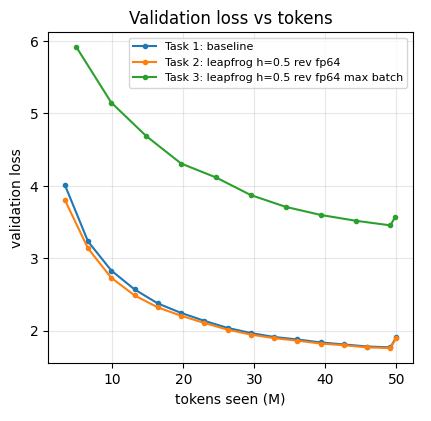

# Assignment 13: Reversible Training of a 20M-Parameter LLM

While a model trains, every layer keeps its intermediate results (the **activations**) so that the backward pass can
compute gradients. For deep models and long sequences this memory, not the weights, is what fills the GPU. A
**reversible** network keeps almost none of it: during the backward pass it recomputes each layer's input from that
layer's output. This assignment trains a 20M-parameter language model on 50M tokens three ways (the standard way,
reversibly, and reversibly at the largest batch that fits) and measures loss, speed and memory.

| | |
|---|---|
| Model | Llama-style decoder written from scratch ([`revllm.py`](revllm.py)): 10 layers, width 384, 6 attention heads, context of 512 tokens. **20,848,512 weights**, 85% of them in the 10 transformer blocks |
| Data | TinyStories, the first 50M tokens. GPT-2 tokenizer, remapped to the 8,192 most frequent tokens (0.2% of tokens became one shared "rare" token). Every run reads the same tokens in the same order, once |
| Training | AdamW, peak learning rate 1.5 × 10⁻³ with warm-up and cosine decay; matrix products in bf16 |
| Hardware | Colab Pro, one NVIDIA L4 (22 GiB usable). The whole notebook takes about 90 minutes |

Notebook: [`session13_reversible.ipynb`](session13_reversible.ipynb), executed with all outputs saved. Every number
below comes from that run. "Loss" means validation loss on 524,288 held-out tokens (lower is better).

## Results

| Task | Result |
|---|---|
| 1. Baseline, batch 64 × 512 tokens | loss **1.909**, **71,229 tokens/s**, peak memory **8.23 GiB** |
| 2. Reversible, same batch | loss **1.899** (same as the baseline), **45,150 tokens/s** (0.63×), peak memory **2.44 GiB** (0.30×) |
| 2. Which reversible variant worked | **leapfrog** with step size h = 0.5, the best of 7 variants; midpoint was the worst |
| 3. Reversible at the largest batch | largest batch **704** sequences, against **160** for the baseline (**4.4×**). Trained at 640: loss **3.569**, **40,983 tokens/s**, peak memory **18.76 GiB** |

Extra findings:

| Finding | Measured |
|---|---|
| The rebuild needs exact arithmetic | With bf16 matrix products and an fp32 hidden-state stream, the rebuilt states were up to 758% wrong and the gradients 18–92% wrong. With an fp64 stream every rebuilt state is **exact** |
| Activation memory per token | baseline **225 KiB**, reversible **55 KiB** (4.1× less) |
| Extra memory for each added layer | baseline **368 MiB**, reversible **31 MiB** (only the layer's weights and optimizer state) |
| Using a bigger batch with the memory saved | 10× fewer weight updates cost **+1.67** in loss |

---

## How reversibility works

**The standard block.** Write $p^\ell$ for the hidden state that enters block $\ell$ (one vector of 384 numbers per
token) and $f_\ell(p)$ for what block $\ell$ adds to it (attention, then the feed-forward layer):

$$p^{\ell+1} = p^\ell + f_\ell(p^\ell)$$

Running this backwards would mean finding $p^\ell$ from $p^{\ell+1}$, but computing $f_\ell(p^\ell)$ already needs
$p^\ell$. So ordinary training **stores** what every block needs for its backward pass: about 225 KiB per token here.

**Three rules that can run backwards** (from Gal et al. 2025, *Reversing Large Language Models*). Each one runs the
block on a state the backward pass already holds and adds the result to a *different* state, so going back is just a
subtraction:

| Rule | Forward | Backward (rebuild) | In words |
|---|---|---|---|
| Midpoint | $p^{\ell+1} = p^{\ell-1} + 2h\, f_\ell(p^\ell)$ | $p^{\ell-1} = p^{\ell+1} - 2h\, f_\ell(p^\ell)$ | add the block's output to the state *two* steps back |
| Leapfrog | $p^{\ell+1} = 2p^\ell - p^{\ell-1} + h^2 f_\ell(p^\ell)$ | $p^{\ell-1} = 2p^\ell - p^{\ell+1} + h^2 f_\ell(p^\ell)$ | the state moves with a "velocity" $p^\ell - p^{\ell-1}$, and each block nudges the velocity |
| Hamiltonian | two streams: attention updates $q$ from $p$, then the feed-forward layer updates $p$ from $q$ | undo the two updates in reverse order | the attention half and the feed-forward half take turns |

- $h$ is a fixed step size, a plain number such as 0.5.
- All three rules use exactly the same weights as the standard model; only the arithmetic around the blocks changes.
- Midpoint and leapfrog need two previous states. Both start from the embedding $x$ ($p^{-1} = p^0 = x$), so the first
  step is an ordinary residual step.

**The backward pass, for each block from the top down:**

1. Hold the two states $p^\ell$ and $p^{\ell+1}$.
2. Re-run block $\ell$ on $p^\ell$.
3. Rebuild the state below by subtraction: $p^{\ell-1} = p^{\ell+1} - 2h\, f_\ell(p^\ell)$ (for midpoint).
4. Back-propagate through the re-run of step 2 to get this block's gradients.
5. Throw the re-run away and move one block down.

At any moment, memory holds two states and one block, whatever the depth. The price is one extra run of every block.
The custom backward is a `torch.autograd.Function` around the 10 blocks; the embedding, head and loss use ordinary
autograd. In float64 its gradients match ordinary autograd to 10⁻¹³ for every rule.

---

## Making the rebuild exact

Step 2 of the backward pass must reproduce the forward pass **exactly**. If the re-run block gives a slightly different
output, the rebuilt state is slightly wrong, the next block re-runs on a wrong input, and the error grows on the way
down.

**Why ordinary precision breaks it.** The matrix products run in bf16, which keeps about 3 significant digits. Near 1.0,
bf16 can only store 1.0000, 1.0078, 1.0156, and so on, and every number is rounded to the nearest of these. With an
fp32 hidden-state stream, a rebuilt state differs from the original by about 1 part in 10 million. That is usually
invisible, but a value sitting exactly at a rounding edge jumps a whole bf16 step:

| | input value | after bf16 rounding |
|---|---|---|
| forward pass | 1.00390624 | 1.0000 |
| re-run on the rebuilt state | 1.00390626 | 1.0078 |

**Measured:** changing a block's input by 10⁻⁷ changed its output by 3.75 × 10⁻³, about 37,000 times more. Near the
bottom of the stack the hidden state is small (the embedding starts at about 0.02), and the normalization inside each
block divides by the size of its input, so the errors are multiplied most there.

**The fix:** keep the stream between blocks in **fp64** (about 16 digits) and convert it to fp32 when it enters a block.
The rebuilt state then converts to exactly the same fp32 numbers as in the forward pass, so the re-run is identical.

| precision | used for |
|---|---|
| bf16 | every matrix product and the attention, forward and backward (automatically, through `torch.autocast`) |
| fp32 | weights, gradients, optimizer state, normalization, the loss, and each block's input |
| fp64 | only the reversible model's stream between blocks: the two kept states, the additions and the rebuild |

Measured at initialisation on real text (relative error of the rebuilt embedding / of the gradients, compared with
ordinary autograd):

| hidden-state stream | midpoint, h = 0.5 | leapfrog, h = 1 | Hamiltonian |
|---|---|---|---|
| fp32 | 191% / 17.7% | 758% / 91.5% | 159% / 53.2% |
| bf16 | 734% / 139% | 1,990% / 110% | 464% / 172% |
| **fp64** | **exact (0) / 0.51%** | **exact (0) / 0.45%** | **exact (0) / 0.43%** |
| fp32, embedding × 50 | 0.14% / 0.47% | – | – |

- With fp64, every rebuilt state is exact for every rule, step size and depth tested, and still after 50M tokens of
  training.
- The small gradient difference left (about 0.5%) is ordinary bf16 noise: two runs of *ordinary* autograd on the same
  input already differ by 0.41%. In fp32 without bf16, both drop to 2.5 × 10⁻⁴.
- fp64 is not essential: an fp32 stream that starts at a sensible size (embedding × 50) is also nearly exact. Our tiny
  starting stream was the real problem.
- Wrong gradients cost real loss: trained on the inexact fp32-stream gradients, midpoint ended 0.23 worse and leapfrog
  0.07 worse after 5M tokens.

*Each line is one rule and stream precision. X-axis: the rebuilt state, from the embedding (0) up through the stack.
Y-axis: relative error against the state the forward pass computed (log scale). The fp64 lines are exactly zero and are
drawn at the bottom.*

---

## Task 1: Baseline

| Setting | Value |
|---|---|
| Batch | 64 sequences × 512 tokens = 32,768 tokens per step, so 1,525 steps for 50M tokens |
| Validation loss | **1.909** (train loss 1.896) |
| Speed | **71,229 tokens/s**, 8.8% of the L4's peak arithmetic rate (MFU) |
| Peak memory | **8.23 GiB** |
| Time | 11.7 minutes |

The speed is 2–3.5× below the 160–250k tokens/s predicted. At width 384 the matrix products are small, so the many
small element-wise operations (normalization, rotary position encoding, dtype conversions) take a large share of the
time, and there is no `torch.compile`. **MFU** (model FLOPs utilisation) is the arithmetic the model needs per second
divided by what the GPU could do at most.

---

## Task 2: Which reversible variant works

Seven reversible variants and the baseline were each trained for 5M tokens with the same data, seed and schedule. Two
extra runs repeat midpoint and leapfrog with the inexact fp32 stream.

| Variant (fp64 stream unless noted) | Loss at 5M tokens | vs baseline | Speed vs baseline | Peak memory |
|---|---:|---:|---:|---:|
| baseline | 4.216 | – | 1.00 | 8.23 GiB |
| **leapfrog, h = 0.5** | **3.875** | **−0.341** | 0.63 | 2.44 GiB |
| leapfrog, h = 1 | 3.919 | −0.296 | 0.63 | 2.44 GiB |
| Hamiltonian | 4.033 | −0.183 | 0.68 | 2.05 GiB |
| midpoint, h = 1 | 4.521 | +0.306 | 0.67 | 2.40 GiB |
| midpoint, h = 0.5 | 4.576 | +0.360 | 0.67 | 2.40 GiB |
| midpoint, h = 0.5, textbook start | 4.694 | +0.478 | 0.68 | 2.39 GiB |
| midpoint, h = 0.25 | 4.754 | +0.539 | 0.67 | 2.40 GiB |
| midpoint, h = 0.5, fp32 stream | 4.810 | +0.594 | 0.76 | 1.89 GiB |
| leapfrog, h = 0.5, fp32 stream | 3.944 | −0.272 | 0.73 | 1.89 GiB |

*Left: training loss (9-step average) against step. Right: validation loss against tokens seen. Black is the baseline;
dashed lines use the inexact fp32 stream. The last point of each curve uses a larger validation set (512 windows
instead of 128), which is why every curve jumps slightly at the end.*

**Leapfrog worked best and midpoint worst**, the opposite of what was predicted. A likely reason: written out over all
10 blocks, midpoint's output only receives the updates of every second block directly (blocks 1, 3, 5, 7, 9), like two
interleaved stacks of half the depth. Leapfrog collects every block's update in its velocity, so every block reaches
the output.

**The full 50M-token run** with leapfrog, h = 0.5, compared with the baseline at the same batch:

| | Baseline | Reversible (leapfrog) | Ratio |
|---|---:|---:|---:|
| Validation loss | 1.9090 | **1.8994** | −0.0096 |
| Train loss (last 20 steps) | 1.8956 | 1.8863 | −0.0093 |
| Speed | 71,229 tokens/s | 45,150 tokens/s | 0.63× |
| Peak memory | 8.23 GiB | **2.44 GiB** | 0.30× |
| Time | 11.7 min | 18.4 min | 1.57× |

The reversible model **matched the baseline**. It led by 0.21 early in training and by 0.01 at the end; with a single
seed, 0.01 means "no worse", not "better". Of the 0.63× speed, about 0.77× comes from re-running the blocks, and the
rest from the fp64 stream (the L4 is slow at fp64 arithmetic).

---

## Task 3: The largest batch

**How the maximum was found:** the batch was doubled from 32 sequences until two training steps ran out of memory,
then narrowed down in steps of 32 sequences. The same search was run for both models.

| | Largest batch that fits | Tokens per step | Peak memory |
|---|---:|---:|---:|
| Baseline | 160 sequences | 81,920 | 18.64 GiB |
| Reversible (leapfrog) | **704 sequences** | 360,448 | 20.69 GiB |
| Ratio | **4.4×** | | |

*Left: training speed against batch size (log scale). Right: peak memory against batch size; the dotted line is the
card's capacity. Larger batches do not make either model faster here; they only use more memory.*

**The 50M-token run at the largest batch** used 640 sequences (704 minus about 5% headroom), which leaves 152 weight
updates instead of 1,525. The learning rate was raised to 4 × 10⁻³ (the usual square-root rule for a larger batch,
capped) with a 10% warm-up.

| | Batch 64 (Task 2) | Batch 640 (Task 3) |
|---|---:|---:|
| Weight updates | 1,525 | 152 |
| Validation loss | **1.899** | 3.569 |
| Speed | 45,150 tokens/s | 40,983 tokens/s |
| Peak memory | 2.44 GiB | 18.76 GiB |

**Why the big batch did so much worse:** with the token budget fixed at 50M, a 10× bigger batch means 10× fewer
weight updates. Compared at a similar number of updates, the two runs are close; compared at the same number of tokens,
the big batch is far behind:

| Comparison (in-training evaluations) | Batch 64 | Batch 640 |
|---|---:|---:|
| After about 100–150 updates | 3.81 at update 100, 3.13 at update 200 | 3.71 at update 105 |
| After 34.4M tokens | about 1.88 | 3.71 |

So the extra tokens in each step bought almost nothing: this small model gets most of what it can from a few tens of
thousands of tokens per step (its *critical batch size*). Reversibility delivered the 4.4× larger batch; spending it on
batch size was the wrong use here. The saved memory is worth more for a deeper model, longer sequences or a smaller GPU.

*Validation loss against tokens seen for the three 50M-token runs. The last point of each curve uses all 1,024
validation windows instead of the first 256, which is why each curve ends with a small jump.*

---

## Where the memory goes

**Memory per token.** Peak memory grows in a straight line with the number of tokens per step; the slope is the
activation memory per token.

| Model | Activation memory per token | Fixed part |
|---|---:|---:|
| Baseline (activations stored) | 224.9 KiB | 1.18 GiB |
| Leapfrog wiring, activations stored | 229.4 KiB | 1.13 GiB |
| Leapfrog, reversible | **55.4 KiB** | 0.80 GiB |

The new wiring on its own changes nothing (229 vs 225 KiB); reversibility cuts the activation memory **4.1×**.

*Peak memory against tokens per step. The slope of each line is the memory each extra token costs.*

**Memory against depth**, at batch 32 × 512:

| Layers | 10 | 20 | 40 | Extra per layer |
|---|---:|---:|---:|---:|
| Baseline | 4.81 GiB | 8.41 GiB | 15.60 GiB | **368 MiB** |
| Reversible | 1.57 GiB | 1.86 GiB | 2.46 GiB | **31 MiB** |

The reversible model's 31 MiB per layer is just the new layer's weights and optimizer state (28 MiB): its activation
memory does not grow with depth at all. At 40 layers it needs 6.3× less memory than the baseline.

*Peak memory against the number of layers, at a batch of 32 sequences.*

**The logits trap.** The output layer produces 8,192 scores for every token. Computed all at once, these add 2.17 GiB
to the baseline and 1.39 GiB to the reversible model at batch 64 (+56% of its peak). Every run therefore computes the
loss in chunks of 8,192 tokens and recomputes each chunk's scores during the backward pass. Without that, the output
layer and not the blocks would decide the largest batch.

---

## Limits of this work

- **One seed per run.** The Task 2 difference (−0.0096) could change with another seed. The screening differences
  (0.18–0.54) are large enough to trust the ranking, but the winner was picked after only 5M tokens.
- **No tuning per variant.** Every run used the same learning rate and schedule; midpoint might do better with its own.
  The Task 3 learning rate came from a capped rule, not a sweep.
- **Memory** was measured as `torch.cuda.max_memory_allocated` over 2-step runs on random tokens. The largest-batch
  search has a resolution of 32 sequences, and the Task 3 run used 640, not the 704 that fit.
- **Speed** is without `torch.compile`, at 5–9% MFU, on a GPU with slow fp64 arithmetic. The 0.77× cost of re-running
  the blocks compares two separate measurements.
- **The scaled-embedding fp32 alternative** was only checked at initialisation, not trained.
- **Vocabulary remap:** the losses are not comparable with models that use the full GPT-2 vocabulary.
- **Execution:** the Colab runtime disconnected during the Task 3 training. That run and the final summary were run
  again in a new runtime; the Task 1 and Task 2 results they use were loaded from the saved outputs. In the notebook's
  last figure (middle panel), those two curves are drawn against the logged point number rather than the step.

## How to run

1. Open [`session13_reversible.ipynb`](session13_reversible.ipynb) on a Colab GPU runtime (an L4 or better). In VS
   Code, connect the Colab kernel.
2. Run all cells. The first cells write `revllm.py`, install `tiktoken`, run a 20-second check of the reversible code,
   and download TinyStories (no Hugging Face token needed). The notebook stops by itself if the reversible stack does
   not rebuild its states exactly.
3. The whole notebook takes about 90 minutes on an L4. The last cell releases the Colab runtime.
