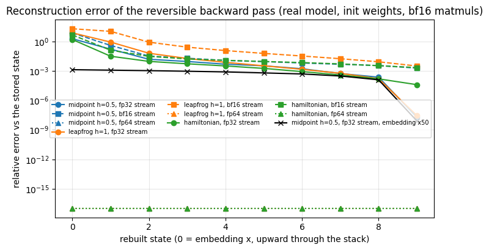
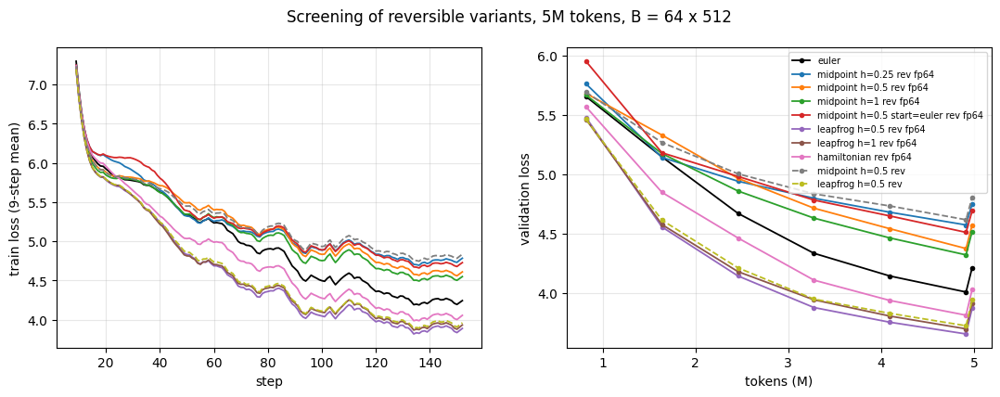
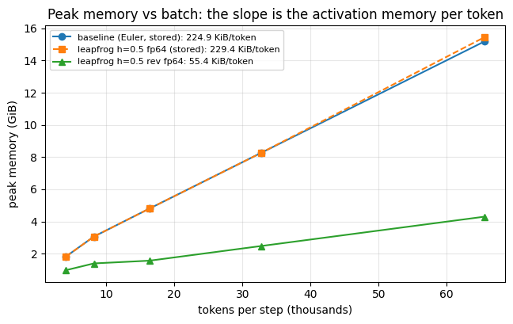
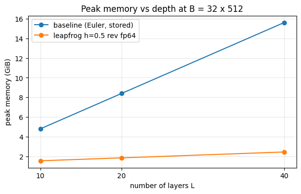
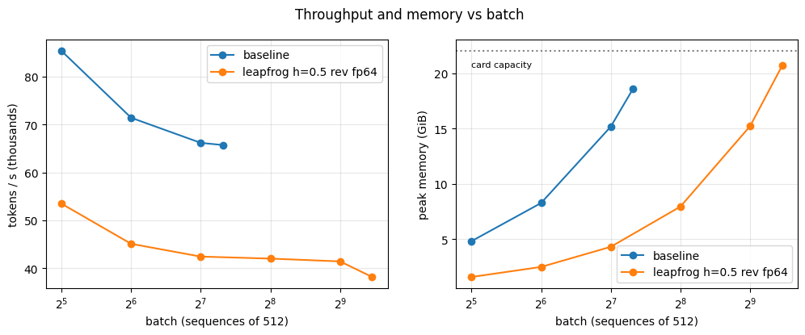
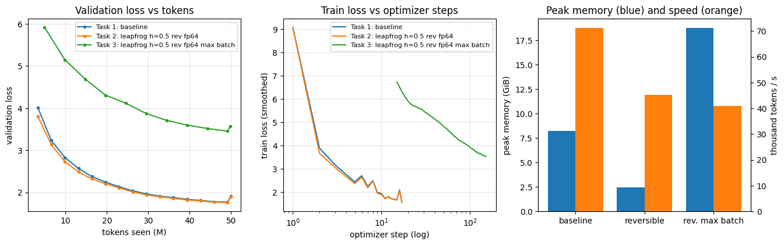

# Assignment 13 — Reversible Training of a 20M-Parameter LLM

Session 13 divides a model's computation across GPUs; its last part (§16–17) removes most of the activations instead.
A **reversible** residual stream stores only the top two hidden states. The backward pass rebuilds every earlier state
by running each block's update rule backwards (one subtraction), re-runs that one block, and back-propagates through
it, so activation memory stops growing with depth. For this assignment I wrote the reversible backward from scratch,
trained a 20.8M-parameter model on 50M tokens three times (standard, reversible, reversible at the largest batch that
fits), screened three reversible schemes, and measured where the memory goes. Along the way it turned out that the
rebuild only works if the backward pass reproduces the forward pass *bit for bit*, which bf16 training breaks; the
notebook measures that failure and its fix.

- **Model:** Llama-style decoder (RMSNorm, RoPE, SwiGLU, tied embedding, no biases), L = 10, D = 384, 6 heads × 64,
  F = 1,024, vocabulary 8,192, context 512: **20,848,512 parameters**, 85% of them in the blocks
  ([`revllm.py`](revllm.py)).
- **Reversible schemes** (Gal et al. 2025, *Reversing Large Language Models*, the paper of lesson §16): midpoint
  $p^{\ell+1} = p^{\ell-1} + 2h f_\ell(p^\ell)$, leapfrog $p^{\ell+1} = 2p^\ell - p^{\ell-1} + h^2 f_\ell(p^\ell)$ and Hamiltonian
  (two coupled streams), with the same parameters as the standard block. One `torch.autograd.Function` (`RevStack`)
  keeps the top two states and rebuilds the rest; everything else is ordinary autograd.
- **Data:** TinyStories, the first 50,000,001 GPT-2 tokens (300k stories), remapped to the 8,191 most frequent ids +
  one RARE id (0.20% of tokens), read **in order, once**, so every run sees the same tokens. Validation: 1,024
  windows of 512 tokens from the official validation split.
- **Training:** AdamW (0.9, 0.95), weight decay 0.1, clipping 1.0, peak lr 1.5 × 10⁻³, 2% warm-up, cosine to 10%; bf16
  autocast; chunked, checkpointed cross-entropy (8,192 tokens per chunk) in every run.
- **Hardware:** one Colab **L4** (22 GiB usable), PyTorch 2.11, no `torch.compile`.

Notebook: [`session13_reversible.ipynb`](session13_reversible.ipynb), executed with every output saved.

## Results

| Task / question | Measured |
|---|---|
| **Task 1: baseline**, B = 64 × 512, 1,525 steps | val loss **1.909**, train 1.896, **71,229 tok/s**, peak **8.23 GiB**, 11.7 min |
| **Task 2: reversible, leapfrog h = 0.5** (fp64 stream), same batch | val loss **1.899**, train 1.886, **45,150 tok/s** (× 0.63), peak **2.44 GiB** (× 0.30), 18.4 min |
| **Task 3: reversible at max batch**, B = 640 × 512, 152 steps | val loss **3.569**, train 3.553, **40,983 tok/s**, peak **18.76 GiB**, 19.6 min |
| Which variant worked (5M-token screening, val loss; baseline 4.216) | **leapfrog h = 0.5: 3.875** · leapfrog h = 1: 3.919 · Hamiltonian: 4.033 · midpoint h = 0.25/0.5/1: 4.754/4.576/4.521 |
| Largest batch that fits on the L4 | baseline **160** sequences, reversible **704** sequences: **× 4.40** |
| Activation memory per token (slope of peak vs batch) | baseline **224.9 KiB**, reversible **55.4 KiB** (× 4.06 less) |
| Peak memory per added layer (B = 32) | baseline **368 MiB**, reversible **31 MiB** (just the layer's weights + Adam state) |
| Gradients vs ordinary autograd, float64 | max relative error **10⁻¹³** for every scheme |
| Same, real model, bf16 matmuls, **fp32 stream** | rebuilt embedding off by **191%** (midpoint), gradients off by **18–92%** |
| Same, **fp64 stream** | rebuilt states **bit-exact (error 0)**; gradient difference 0.43–0.51% = bf16 noise floor (autograd vs itself: 0.41%) |
| Same, fp32 stream with the embedding × 50 | gradient difference 0.47% (at the floor), rebuild error 0.14% |
| Loss cost of the inexact fp32-stream gradients (5M tokens) | **+0.234** (midpoint), **+0.070** (leapfrog) |
| Dropout 0.1 in a reversible stack | gradients off by **113–138%** |
| Trained model (50M tokens), real text | rebuilt states still bit-exact; gradient difference 0.43% |

## 1. How the reversible backward works

A standard block computes $p^{\ell+1} = p^\ell + f_\ell(p^\ell)$, where $f_\ell$ is the block (attention then SwiGLU)
without its "+ input". It cannot be run backwards without solving for $p^\ell$. The reversible rules evaluate the block
on a state the backward pass already holds and add its update to a *different* state, so going down is a subtraction:

| scheme | forward | backward (rebuild) |
|---|---|---|
| midpoint | $p^{\ell+1} = p^{\ell-1} + 2h f_\ell(p^\ell)$ | $p^{\ell-1} = p^{\ell+1} - 2h f_\ell(p^\ell)$ |
| leapfrog | $p^{\ell+1} = 2p^\ell - p^{\ell-1} + h^2 f_\ell(p^\ell)$ | $p^{\ell-1} = 2p^\ell - p^{\ell+1} + h^2 f_\ell(p^\ell)$ |
| Hamiltonian | $q' = q + \text{Attn}(\text{LN}\,p)$, $p' = p + \text{MLP}(\text{LN}\,q')$ | $p = p' - \text{MLP}(\text{LN}\,q')$, $q = q' - \text{Attn}(\text{LN}\,p)$ |

The two starting states of midpoint/leapfrog are the embedding twice ($p^{-1} = p^0 = x$, a "ghost" state), so every
block uses the rule and the backward pass must rebuild $x$ twice: a built-in check. Each backward step holds $(b, c)$
and their gradients, evaluates $f(b)$ **once** with autograd on, and uses it both to rebuild $a$ and to back-propagate:

$$ a = \frac{c - \alpha b - \gamma f(b)}{\beta}, \qquad g_a = \beta g_c, \qquad g_b \mathrel{+}= \alpha g_c + \gamma J_f(b)^\top g_c, $$

with $(\alpha, \beta, \gamma) = (0, 1, 2h)$ for midpoint and $(2, -1, h^2)$ for leapfrog. Before writing the PyTorch
code, a NumPy copy of these recursions was checked against finite differences (relative error 10⁻¹⁰); on the GPU in
float64 the reversible gradients match ordinary autograd to 10⁻¹³ for every scheme and both starting rules.

The plain Euler block can be inverted only by fixed-point iteration $p \leftarrow y - f(p)$. On block 5 of the real model
(local slope 0.46) it converges, but slowly: 9.8 × 10⁻² error after 3 iterations, 3.6 × 10⁻³ after 10, and it stalls at
1.8 × 10⁻⁴: 10–20 extra block forwards per layer for an approximate answer.

## 2. The precision problem, and the fp64 stream

The first full run of the notebook trained reversible models on **wrong gradients** without any error message. On the
real model, with bf16 matrix products and an fp32 residual stream, the rebuilt embedding was off by 191% (midpoint),
758% (leapfrog h = 1) and 159% (Hamiltonian), and the gradients by 18%, 92% and 53%.

The mechanism, measured step by step:

1. Recomputing a block on the *same* input is deterministic: difference **0.000**.
2. Recomputing it on an input that differs by 10⁻⁷ (fp32 rounding, which is how far a rebuilt state is off) changes
   its output by **3.75 × 10⁻³**, 37,000× more: the bf16 casts inside the block round to ≈ 3 significant digits, and
   values sitting at a rounding edge flip by a whole bf16 step.
3. Going down the stack, each wrong output makes the next rebuilt state wrong, and the errors are multiplied most at
   the bottom, where our stream is small (embedding std 0.02) and RMSNorm makes the block's slope large.

**Fix:** keep the residual stream in **fp64** and cast it to fp32 at each block's input (all matrix products stay bf16;
FlashAttention is pinned so forward and recompute use the same kernel). The rebuilt state then casts to exactly the
forward's fp32 bits, the recompute is bit-identical, and every rebuilt state has **error 0**, for all schemes, step
sizes and depths (10 and 40 layers), and still after training. The remaining 0.4–0.7% gradient difference is bf16
noise: ordinary autograd run twice already differs by 0.41%, and without autocast both numbers drop to 2.5 × 10⁻⁴.

**Is fp64 required?** No, if the stream is well scaled. With the embedding multiplied by 50 (stream rms ≈ 1), an fp32
stream gives a 0.47% gradient difference (at the floor) and a 0.14% rebuild error. Our tiny embedding is what made
fp32 fail. Practical reversible models keep an fp32 stream with well-behaved dynamics, use exact fixed-point
arithmetic, or checkpoint every few blocks.

**Why it matters:** the same models trained on the inexact fp32-stream gradients ended 0.234 (midpoint) and 0.070
(leapfrog) worse at 5M tokens than with exact gradients.

## 3. Task 1 — Baseline

1,525 steps of 64 × 512 tokens. Validation loss fell at every evaluation, to **1.909**; peak memory **8.23 GiB**; speed
**71,229 tokens/s**, which is only 8.8% MFU (my prediction was 160–250k tokens/s: at $D = 384$ the matrix products are
small and the unfused element-wise work, the dtype copies and the twice-run head dominate the step). Peak memory was
also above my 6–6.5 GiB estimate: the measured activation cost is 225 KiB per token, not the ≈ 171 I counted by hand.

## 4. Task 2 — Which reversible variant, and the 50M-token run

Ten 5M-token runs with identical data, seed and schedule:

| variant (fp64 stream unless noted) | val loss @ 5M | vs baseline | speed vs baseline | peak GiB |
|---|--:|--:|--:|--:|
| baseline | 4.216 | – | 1.00 | 8.23 |
| **leapfrog h = 0.5** | **3.875** | **−0.341** | 0.63 | 2.44 |
| leapfrog h = 1 | 3.919 | −0.296 | 0.63 | 2.44 |
| Hamiltonian | 4.033 | −0.183 | 0.68 | 2.05 |
| midpoint h = 1 | 4.521 | +0.306 | 0.67 | 2.40 |
| midpoint h = 0.5 | 4.576 | +0.360 | 0.67 | 2.40 |
| midpoint h = 0.5, Euler start | 4.694 | +0.478 | 0.68 | 2.39 |
| midpoint h = 0.25 | 4.754 | +0.539 | 0.67 | 2.40 |
| midpoint h = 0.5, fp32 stream (inexact) | 4.810 | +0.594 | 0.76 | 1.89 |
| leapfrog h = 0.5, fp32 stream (inexact) | 3.944 | −0.272 | 0.73 | 1.89 |

**Leapfrog worked best; midpoint, the rule written in the lesson, worked worst.** My prediction was the opposite. A
likely reason, from unrolling the rules: with the ghost start, midpoint's output is
$p^{10} = x + 2h\,[f_1(p^1) + f_3(p^3) + \dots + f_9(p^9)]$, so only the odd blocks write to the output directly, like two
interleaved half-depth stacks; leapfrog accumulates every update in a velocity,
$p^{10} = x + h^2 \sum_k (10 - k) f_k(p^k)$, so every block reaches the output. (In the trained leapfrog model the stream's
rms grows steadily from 0.05 to 11.1 through the stack.)

**50M tokens, leapfrog h = 0.5, same batch as the baseline:**

| | baseline | reversible | ratio |
|---|--:|--:|--:|
| final validation loss | 1.9090 | **1.8994** | −0.0096 |
| final train loss (last 20 steps) | 1.8956 | 1.8863 | −0.0093 |
| speed | 71,229 tok/s | 45,150 tok/s | × 0.634 |
| peak memory | 8.230 GiB | 2.438 GiB | × 0.296 |

The reversible model **matched the baseline** (it led by 0.21 early and by 0.01 at the end; with one seed that is "no
worse", not "better"). It ran at 0.63× the speed, below my 0.80–0.85 prediction. About 0.77× comes from the recompute
itself (reversible 45.1k vs the same wiring stored 58.6k tok/s), the rest from the fp64 stream: the L4's fp64 units are
slow, and the fp32-stream reversible runs reached 0.73–0.76×.

## 5. Where the memory goes

| | activation memory per token | fixed part |
|---|--:|--:|
| baseline (stored) | 224.9 KiB | 1.18 GiB |
| leapfrog wiring, stored | 229.4 KiB | 1.13 GiB |
| leapfrog, reversible | **55.4 KiB** | 0.80 GiB |

The wiring itself changes nothing (229 vs 225 KiB); reversibility cuts activation memory per token **4.06×**. What the
reversible model still holds per token: the two fp64 states, their gradients and rebuilt neighbours during backward,
and one block's full graph.

The lesson's central claim, measured: at B = 32, peak memory grows by **368 MiB per layer** for the baseline
(4.81 → 8.41 → 15.60 GiB at 10/20/40 layers) and by **31 MiB per layer** for the reversible model (1.57 → 1.86 →
2.46 GiB), which is the 28 MiB of weights and Adam state a layer adds. At 40 layers the reversible model needs 6.3×
less memory.

**The logits trap:** with the cross-entropy un-chunked, the 8,192-entry logits add 2.17 GiB to the baseline and 1.39 GiB
(+56%) to the reversible model at B = 64. Without chunking, the head and not the blocks would decide the maximum
batch, and reversibility would look much less useful than it is.

## 6. Task 3 — The largest batch

- **Maximum batch:** baseline **160** × 512 (peak 18.64 GiB; 192 runs out of memory), reversible **704** × 512 (peak
  20.69 GiB; 736 runs out of memory): **× 4.40**.
- **Throughput does not improve with batch:** baseline 85.4k → 65.7k tok/s from B = 32 to 160, reversible 53.5k →
  38.2k from B = 32 to 704. A bigger batch buys memory headroom, not speed, on this GPU.
- **50M tokens at B = 640** (704 minus ≈ 5% headroom): 152 optimizer steps, peak lr 4 × 10⁻³ ($\sqrt{B}$ rule, capped),
  10% warm-up. Validation **3.569** vs 1.899 at B = 64, **40,983 tok/s**, **peak 18.76 GiB**, no divergence.

The max-batch run lost **1.67** of loss because it took 152 updates instead of 1,525. After its 152 steps it is about
where the B = 64 run was after ~150 steps (3.81 at step 100, 3.13 at step 200), although each of its steps used 10× more
tokens: this model's critical batch size is far below 327,680 tokens per step. Reversibility delivered the 4.4× batch;
spending it on batch size was the wrong use with a fixed 50M-token budget. The memory headroom is worth more as depth
(12× flatter memory per layer), longer context, or a smaller GPU.

Figure notes: the last point of each validation curve jumps up because the in-training evaluations use the first 256
validation windows and the final one all 1,024 (the first 256 are easier; e.g. 1.77 vs 1.91 for the baseline). In the
middle panel, the Task 1 and Task 2 curves have one point per 100 steps (restored from the logs, see Limits) and are
drawn against the point index rather than the step; the left panel shows their progress correctly.

## Limits of this work

- **One seed per configuration.** The Task 2 margin (−0.0096) could change with another seed; the screening margins
  (0.18–0.54) are large enough to trust the ranking, but the winner was chosen at 5M tokens.
- **No per-variant tuning:** every run used peak lr 1.5 × 10⁻³; midpoint might do better with its own learning rate or
  $h$. The max-batch learning rate came from a capped rule, not a sweep.
- **Memory** is `max_memory_allocated` from 2-step probes on random tokens; the maximum-batch search has a resolution
  of 32 sequences, and the 50M run used 640 rather than the 704 that fit.
- **Speed** is without `torch.compile`, at 5–9% MFU, on a GPU with slow fp64; the fp64 stream's cost would be smaller
  on an H100 (not measured). The 0.77× recompute cost compares two different measurements at B = 64.
- **The scaled-embedding fp32 alternative** was checked only at initialisation, not trained. The rounding-flip
  mechanism is supported by the 10⁻⁷ → 3.75 × 10⁻³ sensitivity measurement, not traced element by element.
- **Vocabulary remap:** losses are not comparable with models that use the full GPT-2 vocabulary.
- **Execution:** the Colab runtime disconnected during the Task 3 training. §9.3 and §10 were run in a new runtime
  after re-running setup and data; the Task 1 and Task 2 results they use were restored from the notebook's saved
  outputs, so their curves in the last figure have one point per 100 steps.
- An earlier full run with an fp32 stream (before the precision problem was found) is not in the notebook; its
  numbers are quoted in §4.3 and §6 of the notebook.

## How to run

1. Open [`session13_reversible.ipynb`](session13_reversible.ipynb) on a Colab GPU runtime (L4 or better); in VS Code,
   connect the Colab kernel.
2. Run all cells. The first cells write `revllm.py`, install `tiktoken`, run a 20-second smoke test, and download
   TinyStories in bulk (no HF token needed). §4.3 stops the notebook if the reversible stack does not rebuild its
   states exactly.
3. Total time on an L4 is about 95 minutes (three 50M-token runs, ten 5M-token screening runs, memory probes). The last
   cell releases the Colab runtime.
