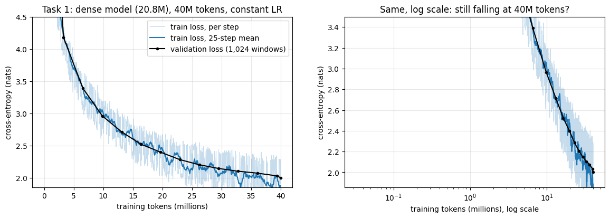
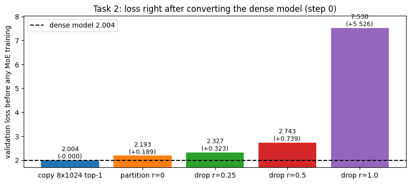
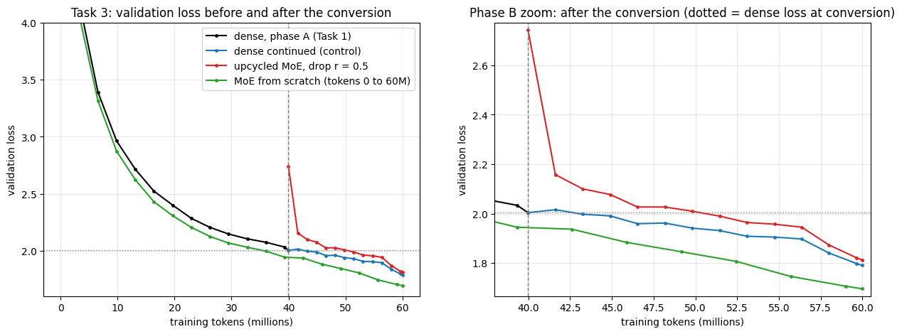
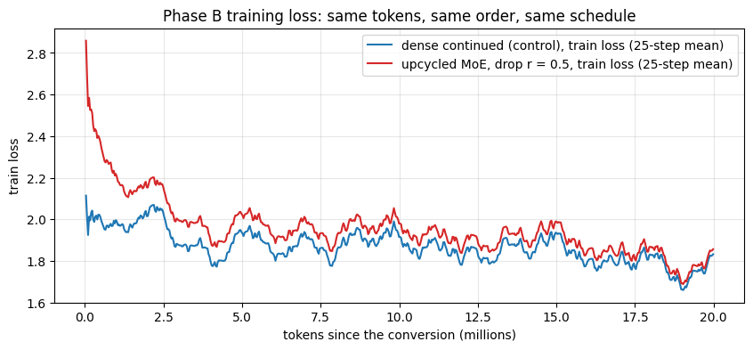
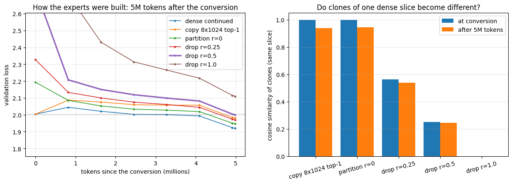
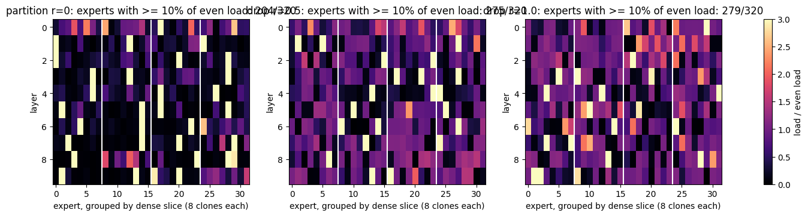
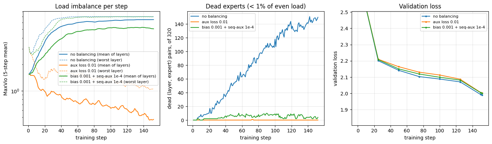
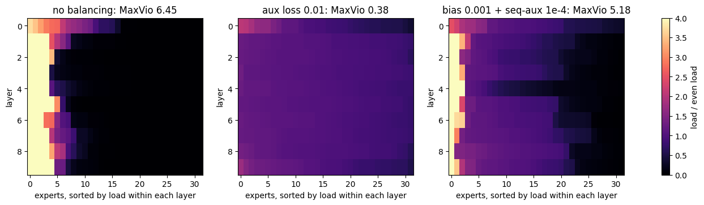
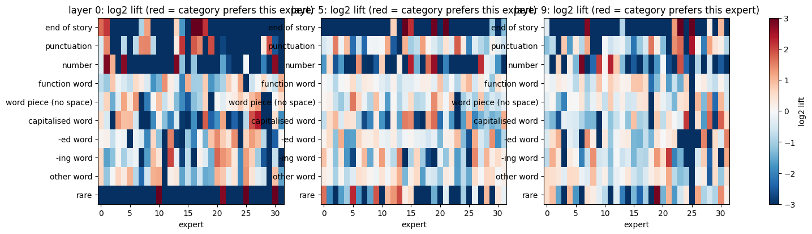
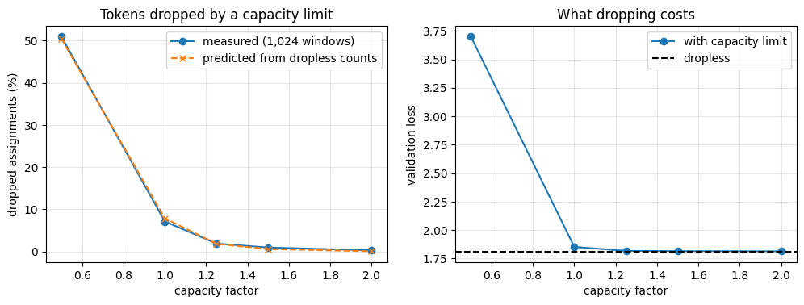

# Assignment 14 — From a Dense LM to a Mixture-of-Experts (Upcycling)

Session 14 is about Mixture-of-Experts (MoE) models: a router sends each token to a few small feed-forward "experts", so
the model can store many more parameters than it uses per token. The assignment: *"Train a Linear model and convert
that into an MoE! Your call on model size and data trained on, but must show they continue to train and reduce loss!"*

I trained a 20.8M-parameter dense decoder on 40M TinyStories tokens. Then I converted every FFN into 32 experts with
**drop-upcycling** (lesson §15) and trained the MoE on 20M new tokens. **Its loss fell at every evaluation, from 2.743
right after the conversion to 1.813.** I compared it with the dense model trained on the same 20M tokens and with the
same MoE trained from scratch. Extra experiments compared five ways of building the experts and three ways of
balancing the load. They also measured what the experts learned and what token dropping costs. Several of my
predictions turned out wrong, and the sections below say which ones.

- **Dense model:** Llama-style decoder (RMSNorm, RoPE, SwiGLU, tied embedding, no biases), L = 10, D = 384,
  6 heads × 64, FFN width F = 1,024, vocabulary 8,192, context 512: **20,848,512 parameters**.
- **MoE model:** the same with each FFN replaced by a router + **32 SwiGLU experts of width 256, top-4**. A token still
  uses 4 × 256 = 1,024 FFN neurons. **103,546,752 total / 20,971,392 active parameters** (4.94×). The router uses fp32
  sigmoid scores with a routed scaling factor of 4. Dispatch is sort-based and dropless. Balancing uses the
  DeepSeek-V3 recipe: an auxiliary-loss-free bias (γ = 0.001) plus a sequence-level auxiliary loss (α = 10⁻⁴). The code
  is in [`moellm.py`](moellm.py).
- **Conversion (upcycling):** attention, norms and embedding are copied. The dense FFN's 1,024 neurons are cut into
  4 slices of 256 and each slice is cloned 8 times. In every expert, a different random half of the neurons is
  redrawn (drop-upcycling, r = 0.5). The router is new.
- **Data:** TinyStories, the first 60,000,001 GPT-2 tokens (300k stories), remapped to the 8,191 most frequent ids +
  one RARE id (0.20% of tokens), and read **in order, once**. Tokens 0–40M train the dense model and 40M–60M come after
  the conversion, so every phase-B run sees the same new text. Validation: 1,024 windows of 512 tokens from the
  official validation split, used for **every** validation number.
- **Training:** batch 64 × 512 = 32,768 tokens; AdamW (0.9, 0.95), weight decay 0.1, clipping 1.0, peak lr 1.5 × 10⁻³,
  bf16 autocast. A **warmup–stable–decay** schedule: the dense phase has no decay (it is a mid-training checkpoint).
  Each phase-B run gets a fresh AdamW, 2% warm-up, and a linear decay to 10% over the last 20% of its steps.
- **Hardware:** one Colab **L4** (22 GiB), PyTorch 2.11, no `torch.compile`. The whole notebook runs in about 2 hours.

Notebook: [`session14_moe_upcycling.ipynb`](session14_moe_upcycling.ipynb), executed with every output saved.
The MoE terms (MaxVio, aux loss vs bias balancing, copy / partition / drop-upcycling, sort-based dropless dispatch,
capacity and token dropping) are explained with tiny worked examples in
[`doubts/s14_moe_terms.md`](doubts/s14_moe_terms.md).

## Results

| Task / question | Measured |
|---|---|
| **Task 1: dense model**, 40M tokens, 1,220 steps | val loss **2.0041**, still falling; 75,984 tok/s, peak 10.36 GiB, 9.2 min |
| **Task 2: convert to MoE**, drop-upcycling r = 0.5 | val loss right after the conversion **2.7429** (+0.739); copy + top-1 reproduces the dense loss exactly (**2.0040**) |
| **Task 3: keep training**, 20M new tokens | **13 of 13** evaluations lower than the previous one: 2.7429 → **1.8130**; below the dense model's 2.0041 after 11.5M tokens |
| Dense continued on the same 20M tokens (control) | 2.0041 → **1.7911** (the MoE ends **0.022 behind**) |
| Same MoE from scratch, 60M tokens (same total compute) | **1.6963**, the best model of all |
| Best way to build the experts (5M tokens, val loss) | **partition r = 0: 1.947** · drop r = 0.25: 1.970 · copy top-1: 1.981 · drop r = 0.5: 2.000 · drop r = 1.0: 2.110 · dense: 1.920 |
| Collapse inside clone families (experts with ≥ 10% of even load) | partition r = 0: **204 of 320** · r = 0.25: 231 · r = 0.5: 275 · r = 1.0: 279 |
| Balancing, 152 steps (MaxVio at the end · dead experts) | none: 6.45 · **140** · aux loss 0.01: **0.50** · **0** · bias + seq aux: 5.19 · 3 |
| Expert specialisation (share of a category in its top-4 experts; even = 12.5%) | end of story 77–99.9%, numbers 59–84%, punctuation 31–56%, function words **20–28%** |
| Token dropping (capacity factor → dropped, loss cost) | CF 1.0: 7.1%, **+0.039** · CF 1.25: 1.9%, +0.005 · CF 2.0: 0.3%, +0.001 |
| Cost, MoE vs dense | total params **4.97×**, active **1.01×**, speed **0.24×**, peak memory **1.64×** |

## 1. Task 1 — The dense model

1,220 steps of 32,768 tokens with warm-up and then a constant learning rate. Validation loss **2.0041** after 40M
tokens, inside my predicted 2.0–2.1. It is still falling at the end: −0.10 over the last 7.2M tokens. That is the point
of not decaying the learning rate: the conversion should start from a mid-training checkpoint, not a "finished" one.

## 2. Task 2 — Converting the dense model into an MoE

A dense SwiGLU FFN is a sum over its neurons, so cutting the neurons into groups gives smaller FFNs that **add back up
to the original**. That is what makes upcycling possible. I built five variants from the same dense checkpoint and
measured each one before any further training:

| variant | experts × width, top-k | val loss at step 0 | jump | tokens whose 4 experts cover all 4 dense slices |
|---|---|--:|--:|--:|
| copy (sparse upcycling) | 8 × 1,024, top-1 | 2.0040 | −0.0000 | – |
| partition r = 0 | 32 × 256, top-4 | 2.1930 | +0.189 | 12.5% |
| drop r = 0.25 | 32 × 256, top-4 | 2.3267 | +0.323 | 12.4% |
| **drop r = 0.5** (main run) | 32 × 256, top-4 | 2.7429 | +0.739 | 12.3% |
| drop r = 1.0 | 32 × 256, top-4 | 7.5300 | +5.526 | 12.6% |

- **Copy + top-1 is exact**, as predicted: whichever copy the router picks is the dense FFN with weight 1. A smoke test
  confirms it at the logits level: relative error 2.5 × 10⁻⁷.
- **Partition jumps** because of the new router. It reproduces the dense FFN only when a token picks one clone of
  every slice. A random router manages that for 11.4% of tokens (hand calculation: 32·24·16·8 / 32·31·30·29), and the
  real one managed 12.5%, with 2.85 distinct slices per token against 2.82 for a random router. So most tokens get
  some slices twice and miss others.
- **The jump grows with the redraw fraction r.** At r = 1.0 the random experts undo 78% of the dense training.

The router itself starts imbalanced, which I had predicted wrongly. In a freshly initialised MoE, one expert in layer 5
received 4.1× the even load (MaxVio 3.06, not "well below 1"). That expert was the top choice for 9 of 10 example
tokens. Its score is higher for almost every token, most likely because all tokens' hidden states share a large
common direction.

## 3. Task 3 — The MoE keeps training and its loss falls

Three runs on the **same 20M new tokens in the same order**, with the same schedule:

| run | tokens | val before | val after | tokens/s | peak GiB | minutes |
|---|---|--:|--:|--:|--:|--:|
| dense, phase A | 0 → 40M | 9.0736 | 2.0041 | 75,984 | 10.36 | 9.2 |
| dense continued (control) | 40M → 60M | 2.0041 | **1.7911** | 75,869 | 10.52 | 4.8 |
| **upcycled MoE, drop r = 0.5** | 40M → 60M | 2.7429 | **1.8130** | 18,460 | 17.31 | 18.9 |
| MoE from scratch | 0 → 60M | 9.0932 | **1.6963** | 18,704 | 17.70 | 54.7 |

**The requirement is met.** The upcycled MoE's validation loss fell at every one of its 13 evaluations (−0.930 in
total). It passed the dense model's conversion-point loss after 11.5M tokens and ended 0.191 below it.

**But it did not beat the dense control, which I had predicted it would.** It ended 0.022 behind. The gap closed
steadily (0.142 after 1.6M tokens, 0.068 after 6.6M, 0.048 after 16.4M, 0.022 at the end), but 20M tokens were not
enough to repay the 0.74 jump from redrawing half of every expert. Because both runs read the same batches, their
training-loss curves wiggle together, and the distance between them is the effect of the model alone:

**The MoE from scratch was the best model, also against my prediction.** All three runs used about the same training
compute (60M tokens × ≈125 MFLOP per token). The from-scratch MoE was already 0.09 ahead of the dense model at 39.3M
tokens (1.945 vs 2.034), at the same constant learning rate. So the MoE design itself works at this scale: 5× the
stored parameters at the same compute per token give a lower loss. What held the upcycled model back was the
conversion.

**When upcycling pays off.** If the dense model already exists, its training is a sunk cost, and the question is what
20M more tokens buy. The upcycled MoE reached 1.813, and the same MoE after its first 20M tokens from scratch was at
2.309. If the dense training is counted, the from-scratch MoE was lower at every phase-B evaluation. The papers in the
lesson find that a from-scratch MoE needs 25–120% extra compute to catch up with an upcycled one. In our run that
crossover had already happened before the conversion: the from-scratch MoE was ahead of the dense model at 40M tokens.

## 4. Which way of building the experts trains best?

All five conversions plus the dense control, each trained on the same 5M tokens:

| variant | val after 5M | vs dense (1.9203) | clone similarity, start → end | experts with ≥ 10% of even load |
|---|--:|--:|--:|--:|
| copy 8 × 1,024, top-1 | 1.9809 | +0.061 | 1.000 → 0.940 | 80 of 80 |
| **partition r = 0** | **1.9468** | **+0.027** | 1.000 → 0.944 | 204 of 320 |
| drop r = 0.25 | 1.9701 | +0.050 | 0.563 → 0.538 | 231 of 320 |
| drop r = 0.5 | 2.0002 | +0.080 | 0.250 → 0.244 | 275 of 320 |
| drop r = 1.0 | 2.1103 | +0.190 | 0.000 → 0.000 | 279 of 320 |

- **Over a short budget, keeping more dense knowledge wins**: partition r = 0, then r = 0.25, 0.5, 1.0. The
  drop-upcycling paper found r = 0.5 best over far longer training, and that does not show at 5M tokens. In hindsight,
  r = 0 or 0.25 would probably have suited my 20M-token main run better. I did not test that.
- **Copy started with no jump but trained worse** (0.055 behind the dense model after 1.6M tokens, while partition was
  only 0.03 behind). With top-1, the renormalised weight is always exactly 1, so the language loss gives the router
  **no gradient at all**: only the balancing bias moves it. Each copy also sees only 1/8 of the batch.
- **Clone similarity starts at (1 − r)²**, as predicted, and barely moves in 5M tokens.
- **Collapse inside clone families**, the failure the lesson describes for the Lightning LM: with partition r = 0,
  116 of 320 experts (36%) end up nearly unused (Lightning LM: 168 of 460, 37%). Redrawing reduces this to 14% at
  r = 0.5. In the heatmap below, each block of 8 columns is one family; a collapsed family has one or two bright clones
  and dark neighbours. The three panels are partition r = 0, drop r = 0.5 and drop r = 1.0 (their titles overlap).

## 5. Balancing: none, auxiliary loss, bias

The same r = 0.5 conversion, the same 5M tokens, three ways of keeping the load even:

| balancing | val after 5M | MaxVio, last 20 steps | worst layer | dead experts (of 320) |
|---|--:|--:|--:|--:|
| none | **1.9892** | 6.45 | 7.00 | **140** |
| aux loss α = 0.01 (Switch) | 2.0016 | **0.50** | 1.08 | **0** |
| bias γ = 0.001 + sequence aux 10⁻⁴ (DeepSeek-V3) | 2.0002 | 5.19 | 6.95 | 3 |

- **No balancing collapses.** In the worst layer MaxVio reaches 7.00, the maximum for top-4 of 32: one expert is
  chosen by every token. 44% of the experts die.
- **The auxiliary loss balanced within about 20 steps.**
- **The bias did not, which I had predicted wrongly.** It moves by exactly 0.001 per step, at most 0.152 in 152 steps.
  Meanwhile Adam trains the router at the full learning rate, so the favoured experts pull away faster than the bias
  can follow. Given time it catches up: in the 610-step main run, MaxVio peaked at ~4.3 near step 150 and fell to 0.42
  by step 600. DeepSeek-V3 trains for hundreds of thousands of steps, so this lag is irrelevant there. It still **kept
  experts alive** (3 dead vs 140), because it lifts every quiet expert each step.
- **Loss differences are at most 0.012**, within single-seed noise at this length.

## 6. What the experts learned

The main MoE after 20M tokens, 65,536 validation tokens routed, tokens grouped into rough categories:

(Panels: layers 0, 5 and 9; rows: end of story, punctuation, number, function word, word piece, capitalised word,
-ed word, -ing word, other word, rare. Some titles and labels overlap.)

- **Concentrated:** end of story (77–99.9% of its assignments in its 4 most-used experts, against 12.5% for even
  routing), numbers (59–84%), punctuation (31–56%), capitalised words (35–55%).
- **Function words are the least concentrated (20–28%), against my prediction.** They make up 36% of all tokens. If
  4 experts took them all, each of those experts would get 2.9× the even load, and balancing pushes back.
- **Specialisation is sharper per token than per category.** In layer 5, ' girl' sends 92% of its occurrences to one
  expert, ' mom' 97% and 'Once' 100%. Several of these tokens typically open a story ("Once upon a time", "One day",
  "named").
- **Consecutive tokens share their top-1 expert** 7–18% of the time, against a chance level of 3.7–4.8%. The ratio grows
  from 1.5× in layer 0 to 3–5× in the deeper layers.

## 7. Capacity and token dropping

The trained MoE evaluated with a capacity limit per expert (dropless in training):

The share of dropped assignments can be predicted from the dropless counts: the first batch alone predicts every value
to within 0.8 percentage points. **CF 1.0 drops 7% of the assignments and costs 0.039**, more than the MoE's whole gap
to the dense model. CF 1.25 costs 0.005, and CF 0.5 breaks the model (3.70). That is the lesson's case for dropless
dispatch.

## 8. Cost

| | dense | upcycled MoE | MoE / dense |
|---|--:|--:|--:|
| total parameters | 20,848,512 | 103,546,752 | 4.97 |
| active parameters | 20,848,512 | 20,971,392 | 1.01 |
| FLOP per token (6 × active) | 125.1M | 125.8M | 1.01 |
| weights + Adam (16 B/param) | 0.33 GB | 1.66 GB | 4.97 |
| measured tokens/s | 75,869 | 18,460 | **0.24** |
| measured peak memory | 10.52 GiB | 17.31 GiB | 1.64 |

Compute follows the active parameters and weight memory follows the total, as the lesson says. **Speed did not follow
the FLOPs** (I predicted 0.6–0.8×). My MoE runs 32 small expert matrix chains per layer in a Python loop, reads the
expert counts back to the CPU once per layer, and gathers and scatters 131,072 token rows. At this size that overhead
costs more than the arithmetic, which is why production MoEs use grouped-GEMM kernels. **Memory grew more than the
weights alone** (1.2 GiB of the 6.8 GiB difference): every token is copied 4 times into the expert buffers, so the
384-wide activations around the experts are 4× the dense model's.

## Limits of this work

- **One seed per run.** Differences of a few thousandths (e.g. the balancing losses) are within noise.
- **Short budgets.** 40M + 20M tokens for the main runs and 5M for the sweeps, while the lesson's comparisons were made
  over hundreds of billions of tokens. The rankings (r = 0.5, bias vs aux, upcycling vs scratch) may differ at scale.
- **r = 0.5 was fixed before the sweep.** The sweep then favoured r = 0, but a 20M-token run with r = 0 was not done.
- **The balancing comparison is only 152 steps**, which favours the auxiliary loss over the slow-acting bias. A larger
  γ was not tried.
- **Not tuned:** the learning rate came from Assignment 13. The router init, γ, the auxiliary coefficients and the
  routed scaling factor follow the lesson.
- **Single GPU, naive dispatch.** No expert parallelism (lesson §16–17 appear only as arithmetic in §1 of the
  notebook). Speed comes from a per-expert Python loop, not a grouped-GEMM kernel, and that 4× slowdown is what
  limited the budgets.
- **Fresh optimizer at the conversion** for every phase-B run, including the dense control.
- **Token categories** in §6 are a hand-made heuristic based on the token text. The "story opening" pattern was
  noticed, not tested.
- **Vocabulary remap:** losses are not comparable with models that use the full GPT-2 vocabulary.
- **Figures:** two heatmap figures have overlapping panel titles. The captions above name the panels.

## How to run

1. Open [`session14_moe_upcycling.ipynb`](session14_moe_upcycling.ipynb) on a Colab GPU runtime (L4 or better). In VS
   Code, connect the Colab kernel.
2. Run all cells. The notebook writes `moellm.py` and runs five smoke tests (about 15 s): dispatch vs a per-token loop,
   function preservation of the conversions, the balancing formulas, and three training steps. It then downloads
   TinyStories in bulk (no HF token needed).
3. Total time on an L4 is about 2 hours. The four main runs take 88 minutes, and the from-scratch MoE alone takes 55
   of them; set `RUN_SCRATCH = False` in §7 to skip it. Plots go to `plots/` and numbers to `results.json`. The last
   cell releases the Colab runtime.
