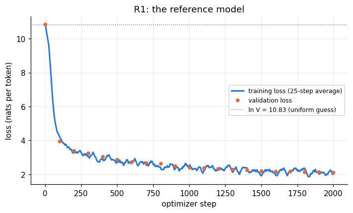
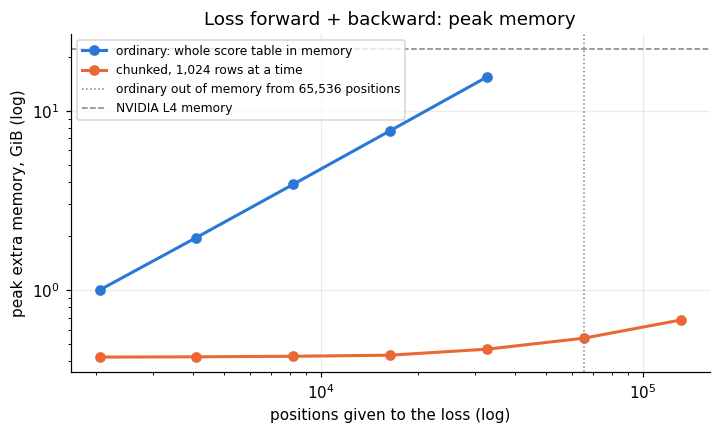
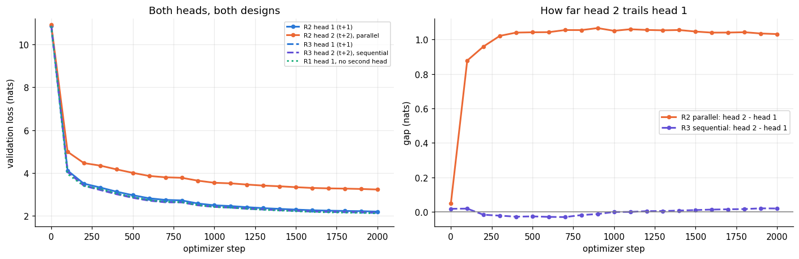
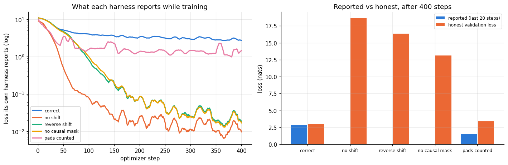

# Assignment 9 — Making the Loss Harness Correct and Observable

Session 9 is about the last layer of a language model: the output head, the logits and the loss. The assignment
gives a four-line **loss harness** and asks to make it correct and observable:

- **Part 1:** seven checks.
- **Part 2:** a second output head that predicts the token after next.
- **Part 3:** a demonstration that a wrong harness can still produce a beautiful loss curve.

I built a 29.9M-parameter decoder with the full GPT-2 vocabulary and trained it on TinyStories. With that
vocabulary the output head (19.3M parameters) is bigger than all six layers together (10.6M). Every check runs on
both the untrained and the trained model. **All numbers below come from one saved run of the notebook.**

```python
hidden = model(tokens)
logits = output_head(hidden)
loss = cross_entropy(logits[:, :-1].reshape(-1, vocab_size), tokens[:, 1:].reshape(-1))
```

**What "harness" means.** The model turns tokens into hidden states, one vector per position. The harness is the code
between those hidden states and the single number the optimizer minimises:
- shifting the tokens to make the targets;
- masking positions that must not count (padding, the joins between packed documents);
- the output head that turns each hidden state into one score per vocabulary entry;
- the cross-entropy and the average.

The word comes from software testing (a *test harness* holds a component and drives it). Mistakes in these few
lines rarely raise an error: the loss still goes down, it just measures the wrong thing.

- **Model:** Llama-style decoder (RMSNorm, pre-norm, RoPE, SwiGLU, no biases), 6 layers, width 384, 6 heads,
  feed-forward width 1,024. Embedding tied with the output head: **29,938,560 parameters**.
- **Vocabulary:** GPT-2's 50,257 tokens + our own `<pad>`, rounded up to **V = 50,304**. GPT-2 has no padding token,
  and reusing `<eot>` would make the padding mask delete every real "end of story" prediction.
- **Data:** TinyStories, the first 16.4M GPT-2 tokens (73,941 stories, about 2.3 per 512-token window), read in
  order, once. Validation: 512 windows of 512 tokens from the official validation split.
- **Training:** 16 × 512 tokens per step, 2,000 steps, AdamW, learning rate 10⁻³ with warm-up and cosine decay, bf16.
  Every run starts from the same initial weights and reads the same tokens in the same order.
- **Harness used for training:** packed stories, the boundary pair masked, and attention that never looks into the
  previous story.
- **Hardware:** one Colab **L4** (22 GiB), PyTorch 2.11. The whole notebook runs in **26.8 minutes**.

Notebook: [`session9_harness.ipynb`](session9_harness.ipynb), executed, with every output saved.
Code: [`lmharness.py`](lmharness.py) (the model, the harness, the hand-written chunked cross-entropy, the training loop).

## Results

| Task | Measured |
|---|---|
| 1. Every shape | hidden (16, 512, 384) = 12 MiB; logits (16, 512, 50,304) = 786 MiB: **131×** as many numbers |
| 2. The shift, as strings | **8,129 of 8,129** scored targets equal the next input, 0 misaligned |
| 3. Padding masked | contributing targets **764 → 485**; trained loss 5.54 with pads counted → **1.62** masked |
| 4. Two packed documents | trained: **2.417 → 2.326** with the boundary masked (→ 2.057 if story B cannot see story A); untrained: 10.868 → 10.869 |
| 5. Untrained perplexity | **52,060 = 1.035 × V**; after training 8.30 |
| 6. Tied vs untied | **29,938,560 vs 49,255,296** parameters (difference 50,304 × 384 = 19,316,736) |
| 7. Peak memory of the loss | ordinary **3.87 GiB** vs chunked **0.43 GiB**: **9.1× less** |
| Part 2: second head for t+2 | head 1 **2.196**, head 2 **3.227**, sum **5.423** (head 2 about 1 nat behind from step 300 on) |
| Part 2, DeepSeek-style second head | head 1 2.132, head 2 2.151, sum 4.283 |
| Part 3: broken harnesses | three copy bugs report **0.01-0.02** while their honest loss is **13-19** |

## The reference model



Several checks barely move on an untrained model, because every token then costs about ln V ≈ 10.83. So a reference
model R1 is trained first, and every Part 1 check is repeated on it. R1 went from 10.854 to a validation loss of
**2.116** (perplexity 8.3, top-1 accuracy 52.3%) in 4.3 minutes, at 63,728 tokens/s and 8.15 GiB peak memory. It was
still improving at the end.

## Part 1, Task 1 — every tensor shape

| Tensor | Shape | dtype | MiB | What the dimensions are |
|---|---|---|---:|---|
| tokens | (16, 512) | int64 | 0.06 | B sequences, T positions |
| embedding(tokens) | (16, 512, 384) | float32 | 12.00 | one 384-wide vector per token |
| attention mask | (16, 1, 512, 512) | bool | 4.00 | query t may see key s; the 1 is shared by all heads |
| q, k, v per head | (16, 6, 512, 64) | bfloat16 | 6.00 | 6 heads of width 64 |
| feed-forward middle | (16, 512, 1024) | bfloat16 | 16.00 | the wide middle of the FFN |
| hidden state | (16, 512, 384) | float32 | 12.00 | what the output head reads |
| logits | (16, 512, 50,304) | bfloat16 | 786.00 | one score per vocabulary entry, at every position |
| `logits[:, :-1].reshape(-1, V)` | (8,176, 50,304) | bfloat16 | 784.46 | one row per prediction; **a copy** |
| targets | (8,176,) | int64 | 0.06 | the true next token of each row |
| loss | () | float32 | | the one number the optimizer pushes down |

The full table, with every intermediate of the first layer, is printed in the notebook. Two things stand out:
- The logits hold 131× as many numbers as the hidden state that produced them, only to be reduced to one number.
- `logits[:, :-1]` is not contiguous, so `.reshape` silently copied another 784.5 MiB. Slicing the hidden state
  before the head gives the same rows for 12 MiB.

## Part 1, Task 2 — the shift, checked with strings

```
 pos  input id  input string     ->  target id  target string   check
   0      3198  'One'            ->       1110  ' day'          ok, target = next input
   1      1110  ' day'           ->         11  ','             ok, target = next input
 161        13  '.'              ->      50256  <eot>           ok, target = next input
 162     50256  <eot>            ->       -100  (ignored)       not scored: next token starts a new story
 163      7454  'Once'           ->       2402  ' upon'         ok, target = next input
```

- Over the whole batch, **8,129 of 8,129** scored targets equal the next input token.
- The 47 unscored targets are exactly the 47 `<eot>` inputs.
- Printed the same way, the two classic bugs are obvious. With no shift, every target equals its own input
  (`'One' -> 'One'`). Shifted the wrong way, every target is the previous word (`' day' -> 'One'`). As integer ids,
  both look like plausible numbers.

## Part 1, Task 3 — padding masked

Four validation stories (50, 102, 145 and 192 tokens) padded to 192. A pair whose input or target is `<pad>` gets
target `-100`, which `cross_entropy(ignore_index=-100)` drops from the sum *and* from the count.

| | Untrained | Trained R1 |
|---|---:|---:|
| contributing targets, pads masked | **485** | 485 |
| contributing targets, pads counted | **764** | 764 |
| loss, pads masked (correct) | 10.829 | **1.624** |
| loss, pads counted | 10.332 | **5.537** |
| loss, pads masked but divided by all positions | 6.874 | 1.031 |
| loss of the pad targets alone | 9.468 | 12.338 |

- The counts match the hand calculation: 4 × (192 − 1) = 764 and the sum of (length − 1) = 485.
- **Dividing by the wrong count** scales the loss by exactly 485/764: it reports a loss 37% too low, only because of
  how much of this batch is padding.
- **Trained:** R1 never saw a `<pad>`, so counting the pads makes its loss 3.4× worse.
- **Untrained, a surprise:** counting the pads made the loss *lower*. 276 of the 279 pad targets are "`<pad>` after
  `<pad>`", which means repeating the current token. A tied model already leans that way at step 0, because its
  output matrix is its input embedding, so the token being read gets a higher score.

## Part 1, Task 4 — two packed documents, boundary masked

Packing `story A <eot> story B` creates one bad pair: `<eot>` → B's first word, which nothing in A can predict.

| | Untrained | Trained R1 |
|---|---:|---:|
| (a) naive: 132 targets | 10.868 | 2.417 |
| loss of the boundary pair alone | 10.691 | **14.307** |
| (b) boundary masked: 131 targets | 10.869 | **2.326** |
| (c) boundary masked, and B cannot see A | 10.853 | **2.057** |
| B's first 8 targets, B can see A | 11.077 | 3.067 |
| B's first 8 targets, B sees only B | 11.246 | **0.707** |

**Why the loss changes.** Masking removes one term from an average. If that term was above the average, the average
falls; if it was below, the average rises.
- Untrained, the boundary pair cost a little less than average, so masking it *raised* the loss by 0.0013.
- Trained, it cost 14.31 against an average of 2.42 (R1 was never trained on what follows an `<eot>`), so masking it
  lowered the loss by 0.091.
- Check: (132 × 2.4168 − 14.3065) / 131 = 2.3260, the measured value.

Letting story B see story A cost even more, because R1 was trained never to look across stories. B's opening "Once
upon a time, there was an old ..." cost 3.07 per token with A in view and 0.71 without it.

## Part 1, Task 5 — perplexity

Perplexity = e^loss: the number of equally likely options the model is effectively choosing between. A model that
knows nothing spreads its guess evenly over all V entries, so its loss is about ln V = ln 50,304 = 10.83 and its
perplexity about V.

- **Measured:** untrained perplexity **52,060 = 1.035 × V** (tied) and 53,514 = 1.064 × V (untied). Both are close to
  V and slightly above it, because random starting scores are not perfectly equal.
- **After training:** 8.30.

The check is cheap but not proof:

| Harness, untrained model | Loss | Perplexity / V | Caught? |
|---|---:|---:|---|
| correct | 10.854 | 1.029 | reference |
| masked sum divided by all positions | 6.874 | 0.019 | yes |
| double softmax: `cross_entropy(softmax(logits))` | 10.826 | 1.000 | **no**: looks perfect |

## Part 1, Task 6 — tied vs untied head

| Model | `parameters()` | `state_dict()` | Second head |
|---|---:|---:|---:|
| tied, one head (R1) | **29,938,560** | 49,255,296 | |
| untied, one head | **49,255,296** | 49,255,296 | |
| tied + parallel t+2 head (R2) | 49,255,296 | 68,572,032 | 19,316,736 |
| tied + sequential t+2 head (R3) | 32,004,864 | 51,321,600 | 2,066,304 |

- The difference is 50,304 × 384 = 19,316,736: the untied head alone is 39.2% of its model.
- `state_dict()` lists the shared matrix under both of its names, so counting with it reports a tied model as if
  it were untied.
- After one batch, **all 50,304 rows** of an untied head had a nonzero gradient, although only 923 different tokens
  were targets. The loss pushes the right token's score up and *every* other score down.
- **A surprise:** the untied embedding got gradient in 924 rows, one fewer than the 925 different input tokens.
  Rebuilding the batch shows the missing row is `<eot>`:
  - every `<eot>` input has its target masked, because the next token starts a new story;
  - no later token may look back at it across the story boundary;
  - so with the correct harness the input embedding of `<eot>` never learns anything.

## Part 1, Task 7 — peak memory, ordinary vs chunked cross-entropy

**Chunked cross-entropy, in plain words.** The ordinary loss builds the whole score table at once (8,176 positions ×
50,304 tokens = 411 million numbers, 1.5 GiB in fp32) and keeps it for the backward pass. But each position's loss
needs only its own row. The chunked version:
1. takes 1,024 positions at a time, computes their rows, keeps one number per row, and throws the rows away;
2. in the backward pass, recomputes each chunk's rows once more to get the gradients.

The loss is the same; only the order of the additions changes. In this run the losses differed by 2.4 × 10⁻⁷ in fp32
and the gradients by at most 2.2 × 10⁻⁵, relative. The code is `ChunkedCrossEntropy` in [`lmharness.py`](lmharness.py).



| Positions given to the loss | Ordinary | Chunked | Ratio |
|---:|---:|---:|---:|
| 2,048 | 1.00 GiB | 0.42 GiB | 2.4× |
| **8,176 (our batch)** | **3.87 GiB** | **0.43 GiB** | **9.1×** |
| 16,384 | 7.72 GiB | 0.43 GiB | 17.9× |
| 32,768 | 15.41 GiB | 0.47 GiB | 33.0× |
| 65,536 | out of memory | 0.54 GiB | |
| 131,072 | out of memory | 0.68 GiB | |

- **Speed:** the chunked version is **2.4× slower** for the loss alone (150.4 vs 63.5 ms). That is more than its one
  extra matrix multiply explains; the rest is this plain-PyTorch version's Python loop.
- **The whole training step** (model + optimizer included):

| Batch | Ordinary | Chunked | Ordinary tokens/s | Chunked tokens/s |
|---:|---:|---:|---:|---:|
| 16 | 5.87 GiB | 2.43 GiB | 64,568 | 41,437 |
| 32 | 10.76 GiB | 3.51 GiB | 61,476 | 40,414 |
| 64 | 20.54 GiB | 5.65 GiB | 43,544 | 38,587 |
| 128 | out of memory | 9.95 GiB | | 37,854 |

## Part 2 — a second head that predicts token t+2

Both heads share the 6 layers, and the training loss is their sum:
- **head 1's loss** is the average over positions of −log of the probability it gave the real next token;
- **head 2's loss** is the same for the token two ahead.

Example: probabilities 0.5, 0.1, 0.9 give penalties 0.69, 2.30, 0.11, and a loss of 1.03.

There are two designs in use, and both were trained:

| | **Parallel** (R2) | **Sequential** (R3) |
|---|---|---|
| used by | Meta's multi-token prediction, Medusa | DeepSeek-V3 |
| head 2 reads | only the hidden state at position t | the hidden state at t **and the embedding of token t+1** (the true one in training, head 1's guess at inference) |
| extra parameters | 19,316,736 (its own output matrix) | 2,066,304 (one extra layer, shared output matrix) |

The parallel head is the literal reading of the assignment: it must guess the word after next without knowing the
next word.



| Run | Head 1 (t+1) | Head 2 (t+2) | Sum | Head-2 accuracy | Drafts accepted |
|---|---:|---:|---:|---:|---:|
| R1, one head | 2.116 | | | | |
| **R2, parallel head 2** | **2.196** | **3.227** | **5.423** | 35.3% | 62.2% |
| R3, sequential head 2 | 2.132 | 2.151 | 4.283 | 51.9% | 83.4% |

**What happens to head 2's loss over training (parallel).**
- Both heads start at about 10.9.
- By the first evaluation (step 100) head 2 already trailed by 0.88 nats. By step 300 the gap was 1.02, and then it
  **stayed flat at 1.03-1.06** to the end. From step 300 on, both heads improved at the same pace, one nat apart: head
  2 gives the right token about e¹ ≈ 2.7 times less probability.
- I had predicted the gap would keep growing. It didn't.
- **Why head 2 trails.** It must predict without the token in between. It is good inside fixed phrases (`' One'` →
  `' day'` 0.54, `' day'` → `','` 0.79) and helpless before content words: after `' his'` it must name the word that
  follows `' best'` without knowing `' best'`, and gives `' friend'` 0.00.

**The sequential head** ends just 0.019 behind head 1, and was even slightly ahead between steps 200 and 1000. It is
told the next word, so it does nearly head 1's job one position later. After `'Once'` it reads `' there'` and is 98%
sure of `' was'`, while the parallel head guessed `' a'` ("Once upon a").

**The cost to head 1.** Adding the parallel head made head 1 0.080 nats worse than R1; the sequential head cost
0.016. The shared layers now serve a second goal.

**Drafting.** At inference, head 2's guess is a free draft of the token after next. The drafts were accepted 62.2%
(parallel) and 83.4% (sequential) of the time on greedy text, so 1.62 and 1.83 tokens per forward pass.

## Part 3 — broken harnesses that train beautifully

A target shift in the wrong direction can still produce a beautiful loss curve. Five 400-step runs start from the
same weights, on the same data. Each logs the loss its **own** harness reports, and is also scored by the correct
harness on validation data.



| Run | The bug | Reported at the end | Honest validation loss |
|---|---|---:|---:|
| correct | none | 2.847 | **3.009** |
| no shift | `cross_entropy(logits, tokens)` | **0.013** | 18.633 |
| reverse shift | `cross_entropy(logits[:, 1:], tokens[:, :-1])` | **0.024** | 16.366 |
| no causal mask | correct targets, attention can look ahead | **0.022** | 13.131 |
| pads counted | one story per row, pad targets scored | 1.503 (real-token loss 3.422) | 3.371 |

- **The copy bugs look over 100× better than the correct run while being useless.** Their honest losses are worse than
  a uniform guess (10.83), and they got worse the longer they trained (no shift: 14.95 at step 100, 18.63 at step 400).
- **No shift learns fastest**, because copying the token a position already holds needs no attention at all. It even
  started lower at step 1 (8.95 vs 10.85): a tied model already favours the token it is reading.
- **Pads counted:** 61.7% of its targets were padding. Its reported loss was 44% of its loss on real tokens.
- **The strings expose three of the four bugs:** `'One'->'One'`, `' day'->'One'`, `<pad>-><pad>`. "No causal mask"
  prints perfectly aligned pairs, and only the honest evaluation catches it.
- **Greedy continuations** of "Once upon a time, there was a little":
  - correct: `girl named Lily. She loved to play outside and play with her friends.`
  - no shift: `little little little little little ...`
  - reverse shift: `a little a little a little ...`
  - no causal mask: `little little little ...`
  - pads counted: `girl named Lily. She loved to play outside in the park with her friends.`

## Limits of this work

- **One seed, one small model.** A 30M model on 16.4M tokens. Differences of a few hundredths of a nat (the head-1 cost
  of each second-head design, the sequential head being briefly ahead) are within what another seed could move. MTP's
  reported gains appear at billions of parameters, which is not tested here.
- **R1 was trained with the fixed harness.** It never saw a `<pad>`, never predicted across an `<eot>` and never
  looked across stories. So the trained numbers in Tasks 3 and 4 show how a correct model reacts to a broken harness,
  not how a model trained on the broken harness behaves. Part 3 trains such models, but only for 400 steps.
- **Peak memory** is `max_memory_allocated`: bytes held by tensors, without the allocator's cache or the CUDA context.
  The out-of-memory points are those of one L4.
- **The chunked loss is plain PyTorch, not a fused GPU kernel**, so its timings show this implementation only.
- **Draft acceptance** is measured on greedy text from a small model, which repeats itself and flatters the numbers.
- **Untested explanations:** why the sequential head was briefly ahead (its extra layer?) and why the no-causal-mask
  model repeats words.
- **The untrained perplexity ratio** depends on one random initialisation (1.035 tied, 1.064 untied, against my
  estimate of 1.08).

## How to run

1. Open [`session9_harness.ipynb`](session9_harness.ipynb) in Colab (or VS Code with a Colab kernel) on a GPU runtime;
   an L4 takes about 27 minutes.
2. Run all cells. The notebook installs `tiktoken`, downloads TinyStories in bulk from the Hugging Face Hub (no token
   needed), writes `lmharness.py` onto the runtime, and saves the plots to `plots/` and every number to
   `results.json`.
3. The last cell releases the Colab runtime.
